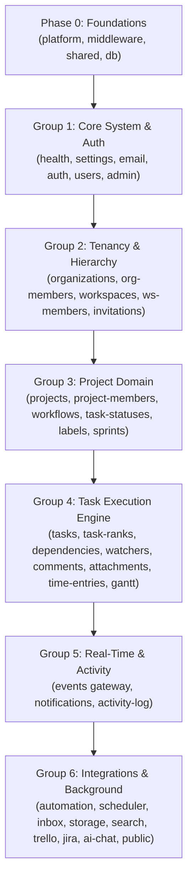

# Orbito Go Twin Backend Migration Plan

> **Architectural Specification & Implementation Blueprint for Go Drop-in Twin**  
> **Source Platform:** `@orbito/backend` (NestJS 11, Prisma ORM 6, Express, PostgreSQL 16, Redis 7, BullMQ)  
> **Target Platform:** `apps/api-go` (Go 1.23+, net/http + Chi v5, pgx/v5, sqlc, slog)  
> **Status:** Implementation In Progress — Phases 0, 1, 2, 3 & Phase 4 (Tasks, Lexorank, Dependencies, Watchers, Labels, Comments, Attachments, Time Entries, Gantt) Complete (Checkpoint 5 Verified)  

---

## Executive Summary & Non-Negotiable Contract

This document specifies the exact architecture, data layer strategy, technical stack, target folder hierarchy, API endpoint parity catalog, testing framework, and rollout plan for building a Go twin backend of the Orbito platform.

### Immutable Constraints
1. **NestJS Unmodified:** The existing NestJS backend (`backend/`) remains completely untouched, fully operational, and passing all unit/e2e tests.
2. **True Drop-In Replacement:** The Go application (`apps/api-go`) runs side by side on a configurable port (defaulting to `:3002` during side-by-side verification and `:3000` for drop-in replacement). The Next.js web application (`frontend/`) and Expo mobile clients require zero code or schema changes—only swapping the API base URL (`NEXT_PUBLIC_API_BASE_URL`).
3. **Database Schema Immutability:** PostgreSQL schema migrations remain strictly owned by Prisma (`backend/prisma`). The Go backend connects to the same database (`orbito` / `focus_flow_db`) and executes parameterized queries generated via `sqlc` without modifying the schema, constraints, or migrations.
4. **Credential & Session Parity:** Zero logout guarantee. Existing user credentials, bcrypt password hashes (cost 12), JWT access tokens (`JWT_SECRET`, 15m), JWT refresh tokens (`JWT_REFRESH_SECRET`, 7d), AES-256-GCM encrypted cookies, and password reset tokens continue working interchangeably between NestJS and Go.
5. **Zero Stubs / No Placeholders:** Every controller, service, background worker, scheduled job, WebSocket event, and utility is ported with 100% parity.

---

## 1. Architecture Summary of the Current NestJS Backend

The NestJS backend is an enterprise-grade work and project management engine organized around clean layered architecture:

```
[ HTTP / WebSocket Ingress ]
             │
   ┌─────────┴─────────┐
   ▼                   ▼
[ Helmet / CORS ]  [ Socket.IO (/events) ]
   │
   ▼
[ CookieParser / Express JSON ] (10MB body limit)
   │
   ▼
[ RequestContextInterceptor ] (x-correlation-id extraction & AsyncLocalStorage)
   │
   ▼
[ ThrottlerGuard ] (Short: 20 req/s, Med: 80 req/10s, Long: 200 req/min)
   │
   ▼
[ JwtAuthGuard & RolesGuard ] (Scope resolution: ORG / WORKSPACE / PROJECT)
   │
   ▼
[ ValidationPipe ] (whitelist, forbidNonWhitelisted, transform)
   │
   ▼
[ Controller ] ──► [ Service ] ──► [ PrismaClient + Audit Middleware ] ──► [ PostgreSQL 16 ]
                           │
                           ├──► [ QueueService (BullMQ / BetterQueue) ] ──► [ Redis 7 ]
                           ├──► [ EventsGateway (Socket.IO) ] ──► [ Real-time Clients ]
                           └──► [ StorageService (Local Disk / S3) ]
```

### 1.1 Ingress & Middleware Chain
- **Trust Proxy:** Configured (`trust proxy: 1`) for reverse proxies (Nginx, Traefik, AWS ALB, Cloudflare).
- **Helmet:** Enabled with `contentSecurityPolicy: false` and `crossOriginEmbedderPolicy: false`.
- **Body Parsing:** Express JSON and URL-encoded limits set to `10mb` for AI chat and file/editor payloads.
- **Cookie Parsing:** Parses signed/unsigned cookies for `access_token` fallback and encrypted `refresh_token`.
- **CORS:** Configured via `CORS_ORIGIN` / `CORS_ORIGINS`, credentials enabled, supporting `http://localhost:3000`, `http://localhost:3001`, `http://127.0.0.1:3000`, and production origins.
- **Global Prefix & Routing:** `RouterModule` registers all 39 domain modules under prefix `/api`. Root `AppController` handles `GET /api` returning `"Welcome to Orbito Backend API!"`.
- **Static Assets:** Serves `uploads/` and static frontend fallbacks via `findPublicDir()` and `createStaticRoutingMiddleware`.

### 1.2 Request Context & Tracing
- `RequestContextInterceptor` checks incoming headers for `x-correlation-id` or `x-request-id`. If absent, generates `randomUUID()`.
- Binds `correlationId`, `userId`, and `user` payload into `RequestContextService` (backed by Node `AsyncLocalStorage`).
- Sets outbound response header `x-correlation-id`.

### 1.3 Global Error Handling & Exception Filter
`GlobalExceptionFilter` guarantees a strict error response structure:
```json
{
  "statusCode": 400,
  "error": "Bad Request",
  "message": ["email must be an email"],
  "path": "/api/auth/register",
  "method": "POST",
  "timestamp": "2026-11-18T12:00:00.000Z",
  "correlationId": "550e8400-e29b-41d4-a716-446655440000"
}
```
Specific database mappings:
- Prisma `P2002` (Unique violation) ──► `409 Conflict`: `"Duplicate entry detected on unique field(s): ..."`
- Prisma `P2025` (Record not found) ──► `404 Not Found`: `"Requested record was not found."`
- Prisma `P2003` (Foreign key violation) ──► `400 Bad Request`: `"Foreign key reference constraint failed on: ..."`
- Other database errors ──► `400 Bad Request`: `"A database operation error occurred."`
- Generic unexpected errors ──► `500 Internal Server Error`: `"An unexpected internal error occurred."` in production, or raw message in development.

### 1.4 Authentication & Session Management
- **Password Hashing:** `bcrypt.hash(password, 12)`.
- **Access Token:** JWT signed with `JWT_SECRET`, default expiry `15m`, algorithm HS256. Payload claims: `{ sub: user.id, email: user.email, role: user.role }`. Extracted from `Authorization: Bearer <token>` or `access_token` cookie.
- **Refresh Token:** JWT signed with `JWT_REFRESH_SECRET`, default expiry `7d`. Stored in plaintext in `User.refreshToken` database column. Sent to client inside httpOnly `refresh_token` cookie encrypted with AES-256-GCM.
- **Cookie Encryption (`cookie-crypto.utils.ts`):**
  - Key: `crypto.createHash('sha256').update(JWT_SECRET).digest()` (32 bytes).
  - IV: 12 random bytes.
  - Tag: 16 bytes GCM auth tag.
  - Value: `${ivHex}:${tagHex}:${ciphertextHex}`.
- **Field-Level Encryption (`encryption.util.ts`):**
  - Key: `crypto.scryptSync(ENCRYPTION_KEY, 'salt', 32)`.
  - Format: `${ivHex}:${authTagHex}:${encryptedHex}` for sensitive credentials (OAuth tokens, API keys).
- **Account Active Guard (`account-active.ts`):**
  - Every token-authenticated request asserts `user.status === 'ACTIVE'` and `user.deletedAt === null`. Inactive or deleted accounts receive immediate `401 Unauthorized` (`"Account is not active"`).
- **System User ID:** `00000000-0000-0000-0000-000000000000` is blocked from authenticating.

### 1.5 Role-Based Access Control (RBAC)
- **Role Hierarchy:** `VIEWER` (0) < `MEMBER` (1) < `MANAGER` (2) < `OWNER` (3) < `SUPER_ADMIN` (4).
- **Super Admin Bypass:** `SUPER_ADMIN` has unrestricted global access.
- **Scope Resolution:**
  - Evaluated against `ORGANIZATION`, `WORKSPACE`, or `PROJECT`.
  - Scope ID extracted in priority order: path params (`req.params`) ──► query params (`req.query`) ──► body (`req.body`). Path parameters can never be overridden by body fields.
  - If target is a slug instead of UUID, resolved dynamically.
  - Project membership fallback: If not directly a member of a project, but project visibility is `INTERNAL`, checks membership in the project's parent workspace.
  - Public project rule: `PUBLIC` visibility grants read-only (`GET`, `HEAD`, `OPTIONS`) to satisfy `VIEWER` role requirement.

### 1.6 Database Persistence & Schema
- **44 Prisma Models:** User, Organization, OrganizationMember, Workspace, WorkspaceMember, Project, ProjectMember, Task, RecurringTask, TaskRank, TaskDependency, Workflow, TaskStatus, StatusTransition, Sprint, Label, WorkspaceLabel, TaskLabel, TaskAssignee, TaskReporter, TaskWatcher, TaskComment, TaskAttachment, PublicTaskShare, TimeEntry, CustomField, Notification, ActivityLog, AutomationRule, RuleExecution, Invitation, ProjectInbox, EmailAccount, InboxMessage, MessageAttachment, InboxRule, MessageRuleResult, EmailSyncLog, TrelloSync, JiraSync, Settings, MediaAsset, Conversation, ChatMessage.
- **26 Enums:** Role, UserStatus, UserSource, ProjectStatus, ProjectPriority, ProjectVisibility, FileType, ScopeType, ViewType, TaskType, TaskPriority, DependencyType, StatusCategory, SprintStatus, CustomFieldType, NotificationType, NotificationPriority, ActivityType, TriggerType, ActionType, RuleStatus, MessageStatus, SyncStatus, RecurrenceType, RecurrenceEndType, InvitationStatus.
- **Audit Middleware:** Automatically populates `createdBy` and `updatedBy` with `currentUserId` from request context across 23 auditable entities.

### 1.7 Real-Time WebSockets (`EventsGateway`)
- Built on Socket.IO running at namespace `/events`.
- Authenticates via JWT in handshake auth (`token`), query param (`token`), or cookie (`access_token`).
- Rooms: `user:<userId>`, `organization:<orgId>`, `workspace:<workspaceId>`, `project:<projectId>`, `task:<taskId>`.
- Client actions: `join:organization`, `leave:organization`, `join:workspace`, `leave:workspace`, `join:project`, `leave:project`, `join:task`, `leave:task`, `typing`, `stop_typing`.
- Broadcast events: `task:created`, `task:updated`, `task:deleted`, `task:status_changed`, `task:assigned`, `comment:added`, `time:started`, `time:stopped`, `sprint:started`, `sprint:completed`, `notification`, `user:online`, `user:offline`.

### 1.8 Asynchronous Processing & Background Jobs
- **BullMQ Queue System:** Fallback to in-memory `BetterQueue` if Redis is offline.
- **Queues:**
  1. `bulk-task-import`: Batch creates tasks from CSV/JSON.
  2. `automation`: Evaluates trigger-condition-action workflow rules asynchronously.
  3. `email`: Dispatches welcome, password reset, invitations, reminders, and digest emails.
  4. `email-sync`: Connects via IMAP (`imapflow`) to pull inbox messages into task comments.
- **Scheduled Jobs (Cron):**
  1. `EVERY_HOUR`: Due date reminder scanner (`SchedulerService.checkDueDateReminders`).
  2. `EVERY_DAY_AT_9AM`: Daily overdue task scanner & alert dispatcher.
  3. `0 9 * * 1` (Monday 9 AM): Weekly sprint summary.
  4. `EVERY_DAY_AT_MIDNIGHT`: Daily overdue task status reconciliation & recurring task instance generation (`RecurringTasksCronService`).
  5. `EVERY_6_HOURS`: Stale token and temporary file cleanup.
  6. `EVERY_WEEK`: Weekly system telemetry & audit archive.
  7. `EVERY_MINUTE`: Trello board poll sync (`TrelloSyncScheduler`).
  8. `EVERY_5_MINUTES`: Project email inbox poll sync (`EmailSyncService`).

---

## 2. Complete Endpoint Inventory Table

Below is the complete inventory of all **386 endpoints** across all 39 modules in the NestJS application, mapped directly to their Go implementation targets.

| Method | Path | Auth | Request DTO / Params | Response | NestJS Source File | Go Target File | Status |
|:---|:---|:---|:---|:---|:---|:---|:---:|

| `GET` | `/api/` | JWT | `limit:string, page:string` | `JSON` | `backend/src/modules/activity-log/activity-log.controller.ts` | `apps/api-go/internal/modules/activity-log/handler.go` | **PENDING** |
| `GET` | `/api/organization/:organizationId/recent` | JWT | `organizationId:string, limit:string, page:string` | `JSON` | `backend/src/modules/activity-log/activity-log.controller.ts` | `apps/api-go/internal/modules/activity-log/handler.go` | **PENDING** |
| `GET` | `/api/organization/:organizationId/stats` | JWT | `organizationId:string, days:string` | `JSON` | `backend/src/modules/activity-log/activity-log.controller.ts` | `apps/api-go/internal/modules/activity-log/handler.go` | **PENDING** |
| `GET` | `/api/project/:projectId` | JWT | `projectId:string, limit:string, page:string` | `JSON` | `backend/src/modules/activity-log/activity-log.controller.ts` | `apps/api-go/internal/modules/activity-log/handler.go` | **PENDING** |
| `GET` | `/api/task/:taskId/activities` | JWT | `taskId:string, limit:string, page:string` | `JSON` | `backend/src/modules/activity-log/activity-log.controller.ts` | `apps/api-go/internal/modules/activity-log/handler.go` | **PENDING** |
| `GET` | `/api/admin/config` | JWT | `-` | `JSON` | `backend/src/modules/admin/admin.controller.ts` | `apps/api-go/internal/modules/admin/handler.go` | **PENDING** |
| `POST` | `/api/admin/config` | JWT | `body` | `JSON` | `backend/src/modules/admin/admin.controller.ts` | `apps/api-go/internal/modules/admin/handler.go` | **PENDING** |
| `POST` | `/api/admin/config/test-smtp` | JWT | `recipientEmail` | `JSON` | `backend/src/modules/admin/admin.controller.ts` | `apps/api-go/internal/modules/admin/handler.go` | **PENDING** |
| `GET` | `/api/admin/dashboard` | JWT | `-` | `JSON` | `backend/src/modules/admin/admin.controller.ts` | `apps/api-go/internal/modules/admin/handler.go` | **PENDING** |
| `GET` | `/api/admin/organizations` | JWT | `-` | `JSON` | `backend/src/modules/admin/admin.controller.ts` | `apps/api-go/internal/modules/admin/handler.go` | **PENDING** |
| `DELETE` | `/api/admin/organizations/:id` | JWT | `id:string` | `JSON` | `backend/src/modules/admin/admin.controller.ts` | `apps/api-go/internal/modules/admin/handler.go` | **PENDING** |
| `GET` | `/api/admin/organizations/:id` | JWT | `id:string` | `JSON` | `backend/src/modules/admin/admin.controller.ts` | `apps/api-go/internal/modules/admin/handler.go` | **PENDING** |
| `PATCH` | `/api/admin/organizations/:id/archive` | JWT | `id:string` | `JSON` | `backend/src/modules/admin/admin.controller.ts` | `apps/api-go/internal/modules/admin/handler.go` | **PENDING** |
| `PATCH` | `/api/admin/organizations/:id/transfer-ownership` | JWT | `string` | `JSON` | `backend/src/modules/admin/admin.controller.ts` | `apps/api-go/internal/modules/admin/handler.go` | **PENDING** |
| `GET` | `/api/admin/users` | JWT | `-` | `JSON` | `backend/src/modules/admin/admin.controller.ts` | `apps/api-go/internal/modules/admin/handler.go` | **PENDING** |
| `DELETE` | `/api/admin/users/:id` | JWT | `id:string` | `JSON` | `backend/src/modules/admin/admin.controller.ts` | `apps/api-go/internal/modules/admin/handler.go` | **PENDING** |
| `GET` | `/api/admin/users/:id` | JWT | `id:string` | `JSON` | `backend/src/modules/admin/admin.controller.ts` | `apps/api-go/internal/modules/admin/handler.go` | **PENDING** |
| `POST` | `/api/admin/users/:id/reset-password` | JWT | `id:string` | `JSON` | `backend/src/modules/admin/admin.controller.ts` | `apps/api-go/internal/modules/admin/handler.go` | **PENDING** |
| `PATCH` | `/api/admin/users/:id/role` | JWT | `UpdateUserRoleDto` | `JSON` | `backend/src/modules/admin/admin.controller.ts` | `apps/api-go/internal/modules/admin/handler.go` | **PENDING** |
| `PATCH` | `/api/admin/users/:id/status` | JWT | `UpdateUserStatusDto` | `JSON` | `backend/src/modules/admin/admin.controller.ts` | `apps/api-go/internal/modules/admin/handler.go` | **PENDING** |
| `POST` | `/api/ai-chat/chat` | JWT | `ChatRequestDto` | `JSON` | `backend/src/modules/ai-chat/ai-chat.controller.ts` | `apps/api-go/internal/modules/ai-chat/handler.go` | **PENDING** |
| `GET` | `/api/ai-chat/config` | JWT | `-` | `JSON` | `backend/src/modules/ai-chat/ai-chat.controller.ts` | `apps/api-go/internal/modules/ai-chat/handler.go` | **PENDING** |
| `DELETE` | `/api/ai-chat/context/:sessionId` | JWT | `sessionId:string` | `JSON` | `backend/src/modules/ai-chat/ai-chat.controller.ts` | `apps/api-go/internal/modules/ai-chat/handler.go` | **PENDING** |
| `GET` | `/api/ai-chat/conversations` | JWT | `-` | `JSON` | `backend/src/modules/ai-chat/ai-chat.controller.ts` | `apps/api-go/internal/modules/ai-chat/handler.go` | **PENDING** |
| `POST` | `/api/ai-chat/conversations` | JWT | `CreateConversationDto` | `JSON` | `backend/src/modules/ai-chat/ai-chat.controller.ts` | `apps/api-go/internal/modules/ai-chat/handler.go` | **PENDING** |
| `DELETE` | `/api/ai-chat/conversations/:id` | JWT | `id:string` | `JSON` | `backend/src/modules/ai-chat/ai-chat.controller.ts` | `apps/api-go/internal/modules/ai-chat/handler.go` | **PENDING** |
| `PATCH` | `/api/ai-chat/conversations/:id` | JWT | `RenameConversationDto` | `JSON` | `backend/src/modules/ai-chat/ai-chat.controller.ts` | `apps/api-go/internal/modules/ai-chat/handler.go` | **PENDING** |
| `PUT` | `/api/ai-chat/conversations/:id/messages` | JWT | `UpdateMessagesDto` | `JSON` | `backend/src/modules/ai-chat/ai-chat.controller.ts` | `apps/api-go/internal/modules/ai-chat/handler.go` | **PENDING** |
| `POST` | `/api/ai-chat/generate-description` | JWT | `GenerateDescriptionDto` | `JSON` | `backend/src/modules/ai-chat/ai-chat.controller.ts` | `apps/api-go/internal/modules/ai-chat/handler.go` | **PENDING** |
| `POST` | `/api/ai-chat/test-connection` | JWT | `TestConnectionDto` | `JSON` | `backend/src/modules/ai-chat/ai-chat.controller.ts` | `apps/api-go/internal/modules/ai-chat/handler.go` | **PENDING** |
| `GET` | `/api` | Public | `-` | `JSON` | `backend/src/app.controller.ts` | `apps/api-go/internal/modules/app/handler.go` | **PENDING** |
| `GET` | `/api/auth/access-control` | JWT | `scope:ScopeType, id:string` | `JSON` | `backend/src/modules/auth/auth.controller.ts` | `apps/api-go/internal/modules/auth/handler.go` | **PENDING** |
| `POST` | `/api/auth/forgot-password` | Public | `ForgotPasswordDto` | `JSON` | `backend/src/modules/auth/auth.controller.ts` | `apps/api-go/internal/modules/auth/handler.go` | **PENDING** |
| `POST` | `/api/auth/login` | Public | `LoginDto` | `JSON` | `backend/src/modules/auth/auth.controller.ts` | `apps/api-go/internal/modules/auth/handler.go` | **PENDING** |
| `POST` | `/api/auth/logout` | JWT | `-` | `JSON` | `backend/src/modules/auth/auth.controller.ts` | `apps/api-go/internal/modules/auth/handler.go` | **PENDING** |
| `GET` | `/api/auth/me` | JWT | `-` | `JSON` | `backend/src/modules/auth/auth.controller.ts` | `apps/api-go/internal/modules/auth/handler.go` | **PENDING** |
| `GET` | `/api/auth/oidc/callback` | Public | `code:string, state:string` | `JSON` | `backend/src/modules/auth/auth.controller.ts` | `apps/api-go/internal/modules/auth/handler.go` | **PENDING** |
| `GET` | `/api/auth/oidc/config` | Public | `-` | `JSON` | `backend/src/modules/auth/auth.controller.ts` | `apps/api-go/internal/modules/auth/handler.go` | **PENDING** |
| `POST` | `/api/auth/oidc/exchange` | Public | `-` | `JSON` | `backend/src/modules/auth/auth.controller.ts` | `apps/api-go/internal/modules/auth/handler.go` | **PENDING** |
| `GET` | `/api/auth/oidc/login` | Public | `-` | `JSON` | `backend/src/modules/auth/auth.controller.ts` | `apps/api-go/internal/modules/auth/handler.go` | **PENDING** |
| `GET` | `/api/auth/profile` | JWT | `-` | `JSON` | `backend/src/modules/auth/auth.controller.ts` | `apps/api-go/internal/modules/auth/handler.go` | **PENDING** |
| `POST` | `/api/auth/refresh` | Public | `RefreshTokenDto` | `JSON` | `backend/src/modules/auth/auth.controller.ts` | `apps/api-go/internal/modules/auth/handler.go` | **PENDING** |
| `POST` | `/api/auth/register` | Public | `RegisterDto` | `JSON` | `backend/src/modules/auth/auth.controller.ts` | `apps/api-go/internal/modules/auth/handler.go` | **PENDING** |
| `GET` | `/api/auth/registration-status` | Public | `-` | `JSON` | `backend/src/modules/auth/auth.controller.ts` | `apps/api-go/internal/modules/auth/handler.go` | **PENDING** |
| `POST` | `/api/auth/reset-password` | Public | `ResetPasswordDto` | `JSON` | `backend/src/modules/auth/auth.controller.ts` | `apps/api-go/internal/modules/auth/handler.go` | **PENDING** |
| `POST` | `/api/auth/setup` | Public | `SetupAdminDto` | `JSON` | `backend/src/modules/auth/auth.controller.ts` | `apps/api-go/internal/modules/auth/handler.go` | **PENDING** |
| `GET` | `/api/auth/setup/required` | Public | `-` | `JSON` | `backend/src/modules/auth/auth.controller.ts` | `apps/api-go/internal/modules/auth/handler.go` | **PENDING** |
| `GET` | `/api/auth/verify-reset-token/:token` | Public | `token:string` | `JSON` | `backend/src/modules/auth/auth.controller.ts` | `apps/api-go/internal/modules/auth/handler.go` | **PENDING** |
| `GET` | `/api/automation/rules` | JWT | `-` | `JSON` | `backend/src/modules/automation/automation.controller.ts` | `apps/api-go/internal/modules/automation/handler.go` | **PENDING** |
| `POST` | `/api/automation/rules` | JWT | `CreateAutomationRuleDto` | `JSON` | `backend/src/modules/automation/automation.controller.ts` | `apps/api-go/internal/modules/automation/handler.go` | **PENDING** |
| `DELETE` | `/api/automation/rules/:id` | JWT | `id:string` | `JSON` | `backend/src/modules/automation/automation.controller.ts` | `apps/api-go/internal/modules/automation/handler.go` | **PENDING** |
| `GET` | `/api/automation/rules/:id` | JWT | `id:string` | `JSON` | `backend/src/modules/automation/automation.controller.ts` | `apps/api-go/internal/modules/automation/handler.go` | **PENDING** |
| `PATCH` | `/api/automation/rules/:id` | JWT | `Partial<CreateAutomationRuleDto>` | `JSON` | `backend/src/modules/automation/automation.controller.ts` | `apps/api-go/internal/modules/automation/handler.go` | **PENDING** |
| `GET` | `/api/automation/rules/:id/stats` | JWT | `id:string` | `JSON` | `backend/src/modules/automation/automation.controller.ts` | `apps/api-go/internal/modules/automation/handler.go` | **PENDING** |
| `PATCH` | `/api/automation/rules/:id/toggle` | JWT | `id:string` | `JSON` | `backend/src/modules/automation/automation.controller.ts` | `apps/api-go/internal/modules/automation/handler.go` | **PENDING** |
| `POST` | `/api/editor-images/upload` | JWT | `-` | `JSON` | `backend/src/modules/editor-images/editor-images.controller.ts` | `apps/api-go/internal/modules/editor-images/handler.go` | **PENDING** |
| `GET` | `/api/email/queue/stats` | JWT | `-` | `JSON` | `backend/src/modules/email/email.controller.ts` | `apps/api-go/internal/modules/email/handler.go` | **PENDING** |
| `POST` | `/api/email/send` | JWT | `SendEmailDto` | `JSON` | `backend/src/modules/email/email.controller.ts` | `apps/api-go/internal/modules/email/handler.go` | **PENDING** |
| `POST` | `/api/email/send-bulk` | JWT | `BulkEmailDto` | `JSON` | `backend/src/modules/email/email.controller.ts` | `apps/api-go/internal/modules/email/handler.go` | **PENDING** |
| `GET` | `/api/gantt/project/:projectId` | JWT | `projectId:string` | `JSON` | `backend/src/modules/gantt/gantt.controller.ts` | `apps/api-go/internal/modules/gantt/handler.go` | **DONE** |
| `GET` | `/api/gantt/project/:projectId/resources` | JWT | `projectId:string` | `JSON` | `backend/src/modules/gantt/gantt.controller.ts` | `apps/api-go/internal/modules/gantt/handler.go` | **DONE** |
| `GET` | `/api/gantt/sprint/:sprintId` | JWT | `sprintId:string` | `JSON` | `backend/src/modules/gantt/gantt.controller.ts` | `apps/api-go/internal/modules/gantt/handler.go` | **DONE** |
| `GET` | `/api/health` | Public | `-` | `JSON` | `backend/src/modules/health/health.controller.ts` | `apps/api-go/internal/modules/health/handler.go` | **PENDING** |
| `GET` | `/api/health/liveness` | Public | `-` | `JSON` | `backend/src/modules/health/health.controller.ts` | `apps/api-go/internal/modules/health/handler.go` | **PENDING** |
| `GET` | `/api/health/readiness` | Public | `-` | `JSON` | `backend/src/modules/health/health.controller.ts` | `apps/api-go/internal/modules/health/handler.go` | **PENDING** |
| `GET` | `/api/email-templates` | JWT | `-` | `JSON` | `backend/src/modules/inbox/controllers/email-templates.controller.ts` | `apps/api-go/internal/modules/inbox/handler.go` | **PENDING** |
| `GET` | `/api/email-templates/:id` | JWT | `id:string` | `JSON` | `backend/src/modules/inbox/controllers/email-templates.controller.ts` | `apps/api-go/internal/modules/inbox/handler.go` | **PENDING** |
| `GET` | `/api/email-templates/categories` | JWT | `-` | `JSON` | `backend/src/modules/inbox/controllers/email-templates.controller.ts` | `apps/api-go/internal/modules/inbox/handler.go` | **PENDING** |
| `GET` | `/api/email-templates/variables` | JWT | `-` | `JSON` | `backend/src/modules/inbox/controllers/email-templates.controller.ts` | `apps/api-go/internal/modules/inbox/handler.go` | **PENDING** |
| `GET` | `/api/projects/:projectId/inbox` | JWT | `projectId:string` | `JSON` | `backend/src/modules/inbox/controllers/project-inbox.controller.ts` | `apps/api-go/internal/modules/inbox/handler.go` | **PENDING** |
| `POST` | `/api/projects/:projectId/inbox` | JWT | `CreateInboxDto` | `JSON` | `backend/src/modules/inbox/controllers/project-inbox.controller.ts` | `apps/api-go/internal/modules/inbox/handler.go` | **PENDING** |
| `PUT` | `/api/projects/:projectId/inbox` | JWT | `UpdateInboxDto` | `JSON` | `backend/src/modules/inbox/controllers/project-inbox.controller.ts` | `apps/api-go/internal/modules/inbox/handler.go` | **PENDING** |
| `PUT` | `/api/projects/:projectId/inbox/email-account` | JWT | `SetupEmailDto` | `JSON` | `backend/src/modules/inbox/controllers/project-inbox.controller.ts` | `apps/api-go/internal/modules/inbox/handler.go` | **PENDING** |
| `GET` | `/api/projects/:projectId/inbox/messages` | JWT | `projectId:string, filters:MessageFiltersDto` | `JSON` | `backend/src/modules/inbox/controllers/project-inbox.controller.ts` | `apps/api-go/internal/modules/inbox/handler.go` | **PENDING** |
| `GET` | `/api/projects/:projectId/inbox/messages/:messageId` | JWT | `messageId:string` | `JSON` | `backend/src/modules/inbox/controllers/project-inbox.controller.ts` | `apps/api-go/internal/modules/inbox/handler.go` | **PENDING** |
| `POST` | `/api/projects/:projectId/inbox/messages/:messageId/convert` | JWT | `messageId:string` | `JSON` | `backend/src/modules/inbox/controllers/project-inbox.controller.ts` | `apps/api-go/internal/modules/inbox/handler.go` | **PENDING** |
| `POST` | `/api/projects/:projectId/inbox/messages/:messageId/ignore` | JWT | `messageId:string` | `JSON` | `backend/src/modules/inbox/controllers/project-inbox.controller.ts` | `apps/api-go/internal/modules/inbox/handler.go` | **PENDING** |
| `GET` | `/api/projects/:projectId/inbox/rules` | JWT | `projectId:string` | `JSON` | `backend/src/modules/inbox/controllers/project-inbox.controller.ts` | `apps/api-go/internal/modules/inbox/handler.go` | **PENDING** |
| `POST` | `/api/projects/:projectId/inbox/rules` | JWT | `CreateRuleDto` | `JSON` | `backend/src/modules/inbox/controllers/project-inbox.controller.ts` | `apps/api-go/internal/modules/inbox/handler.go` | **PENDING** |
| `DELETE` | `/api/projects/:projectId/inbox/rules/:ruleId` | JWT | `ruleId:string` | `JSON` | `backend/src/modules/inbox/controllers/project-inbox.controller.ts` | `apps/api-go/internal/modules/inbox/handler.go` | **PENDING** |
| `PUT` | `/api/projects/:projectId/inbox/rules/:ruleId` | JWT | `CreateRuleDto` | `JSON` | `backend/src/modules/inbox/controllers/project-inbox.controller.ts` | `apps/api-go/internal/modules/inbox/handler.go` | **PENDING** |
| `POST` | `/api/projects/:projectId/inbox/sync` | JWT | `projectId:string` | `JSON` | `backend/src/modules/inbox/controllers/project-inbox.controller.ts` | `apps/api-go/internal/modules/inbox/handler.go` | **PENDING** |
| `POST` | `/api/projects/:projectId/inbox/test-email/:accountId` | JWT | `accountId:string` | `JSON` | `backend/src/modules/inbox/controllers/project-inbox.controller.ts` | `apps/api-go/internal/modules/inbox/handler.go` | **PENDING** |
| `POST` | `/api/tasks/:taskId/comments/:commentId/send-email` | JWT | `taskId:string, commentId:string` | `JSON` | `backend/src/modules/inbox/controllers/task-comment-email.controller.ts` | `apps/api-go/internal/modules/inbox/handler.go` | **PENDING** |
| `POST` | `/api/invitations` | JWT | `CreateInvitationDto` | `JSON` | `backend/src/modules/invitations/invitations.controller.ts` | `apps/api-go/internal/modules/invitations/handler.go` | **PENDING** |
| `DELETE` | `/api/invitations/:id` | JWT | `id:string` | `JSON` | `backend/src/modules/invitations/invitations.controller.ts` | `apps/api-go/internal/modules/invitations/handler.go` | **PENDING** |
| `POST` | `/api/invitations/:id/resend` | JWT | `id:string` | `JSON` | `backend/src/modules/invitations/invitations.controller.ts` | `apps/api-go/internal/modules/invitations/handler.go` | **PENDING** |
| `PATCH` | `/api/invitations/:token/accept` | JWT | `token:string` | `JSON` | `backend/src/modules/invitations/invitations.controller.ts` | `apps/api-go/internal/modules/invitations/handler.go` | **PENDING** |
| `PATCH` | `/api/invitations/:token/decline` | JWT | `token:string` | `JSON` | `backend/src/modules/invitations/invitations.controller.ts` | `apps/api-go/internal/modules/invitations/handler.go` | **PENDING** |
| `GET` | `/api/invitations/entity/:entityType/:entityId` | JWT | `entityId:string` | `JSON` | `backend/src/modules/invitations/invitations.controller.ts` | `apps/api-go/internal/modules/invitations/handler.go` | **PENDING** |
| `GET` | `/api/invitations/user` | JWT | `-` | `JSON` | `backend/src/modules/invitations/invitations.controller.ts` | `apps/api-go/internal/modules/invitations/handler.go` | **PENDING** |
| `GET` | `/api/invitations/verify/:token` | Public | `token:string` | `JSON` | `backend/src/modules/invitations/invitations.controller.ts` | `apps/api-go/internal/modules/invitations/handler.go` | **PENDING** |
| `DELETE` | `/api/jira-sync/:projectId` | JWT (Roles: MANAGER, OWNER) | `projectId:string` | `JSON` | `backend/src/modules/jira-sync/jira-sync.controller.ts` | `apps/api-go/internal/modules/jira-sync/handler.go` | **PENDING** |
| `GET` | `/api/jira-sync/:projectId` | JWT (Roles: MEMBER, MANAGER, OWNER) | `projectId:string` | `JSON` | `backend/src/modules/jira-sync/jira-sync.controller.ts` | `apps/api-go/internal/modules/jira-sync/handler.go` | **PENDING** |
| `PATCH` | `/api/jira-sync/:projectId` | JWT (Roles: MANAGER, OWNER) | `UpdateJiraSyncDto` | `JSON` | `backend/src/modules/jira-sync/jira-sync.controller.ts` | `apps/api-go/internal/modules/jira-sync/handler.go` | **PENDING** |
| `GET` | `/api/jira-sync/:projectId/statuses` | JWT (Roles: MEMBER, MANAGER, OWNER) | `projectId:string` | `JSON` | `backend/src/modules/jira-sync/jira-sync.controller.ts` | `apps/api-go/internal/modules/jira-sync/handler.go` | **PENDING** |
| `POST` | `/api/jira-sync/:projectId/sync` | JWT (Roles: MEMBER, MANAGER, OWNER) | `projectId:string` | `JSON` | `backend/src/modules/jira-sync/jira-sync.controller.ts` | `apps/api-go/internal/modules/jira-sync/handler.go` | **PENDING** |
| `POST` | `/api/jira-sync/connect` | JWT (Roles: MANAGER, OWNER) | `ConnectJiraDto` | `JSON` | `backend/src/modules/jira-sync/jira-sync.controller.ts` | `apps/api-go/internal/modules/jira-sync/handler.go` | **PENDING** |
| `POST` | `/api/jira-sync/validate/projects` | JWT (Roles: MEMBER, MANAGER, OWNER) | `ValidateJiraCredentialsDto` | `JSON` | `backend/src/modules/jira-sync/jira-sync.controller.ts` | `apps/api-go/internal/modules/jira-sync/handler.go` | **PENDING** |
| `POST` | `/api/jira-sync/validate/statuses` | JWT (Roles: MEMBER, MANAGER, OWNER) | `ValidateJiraProjectStatusesDto` | `JSON` | `backend/src/modules/jira-sync/jira-sync.controller.ts` | `apps/api-go/internal/modules/jira-sync/handler.go` | **PENDING** |
| `DELETE` | `/api/workspaces/:workspaceId/jira-sync` | JWT (Roles: MANAGER, OWNER) | `workspaceId:string` | `JSON` | `backend/src/modules/jira-sync/jira-workspace.controller.ts` | `apps/api-go/internal/modules/jira-sync/handler.go` | **PENDING** |
| `GET` | `/api/workspaces/:workspaceId/jira-sync` | JWT (Roles: MANAGER, OWNER) | `workspaceId:string` | `JSON` | `backend/src/modules/jira-sync/jira-workspace.controller.ts` | `apps/api-go/internal/modules/jira-sync/handler.go` | **PENDING** |
| `PATCH` | `/api/workspaces/:workspaceId/jira-sync` | JWT (Roles: MANAGER, OWNER) | `ConnectJiraWorkspaceDto` | `JSON` | `backend/src/modules/jira-sync/jira-workspace.controller.ts` | `apps/api-go/internal/modules/jira-sync/handler.go` | **PENDING** |
| `POST` | `/api/workspaces/:workspaceId/jira-sync/connect` | JWT (Roles: MANAGER, OWNER) | `ConnectJiraWorkspaceDto` | `JSON` | `backend/src/modules/jira-sync/jira-workspace.controller.ts` | `apps/api-go/internal/modules/jira-sync/handler.go` | **PENDING** |
| `POST` | `/api/workspaces/:workspaceId/jira-sync/import` | JWT (Roles: MANAGER, OWNER) | `ImportJiraProjectsDto` | `JSON` | `backend/src/modules/jira-sync/jira-workspace.controller.ts` | `apps/api-go/internal/modules/jira-sync/handler.go` | **PENDING** |
| `GET` | `/api/workspaces/:workspaceId/jira-sync/projects` | JWT (Roles: MANAGER, OWNER) | `workspaceId:string` | `JSON` | `backend/src/modules/jira-sync/jira-workspace.controller.ts` | `apps/api-go/internal/modules/jira-sync/handler.go` | **PENDING** |
| `GET` | `/api/workspaces/:workspaceId/jira-sync/projects/:projectKey/statuses` | JWT (Roles: MANAGER, OWNER) | `workspaceId:string, projectKey:string` | `JSON` | `backend/src/modules/jira-sync/jira-workspace.controller.ts` | `apps/api-go/internal/modules/jira-sync/handler.go` | **PENDING** |
| `POST` | `/api/workspaces/:workspaceId/jira-sync/sync-all` | JWT (Roles: MANAGER, OWNER) | `workspaceId:string` | `JSON` | `backend/src/modules/jira-sync/jira-workspace.controller.ts` | `apps/api-go/internal/modules/jira-sync/handler.go` | **PENDING** |
| `GET` | `/api/workspaces/:workspaceId/jira-sync/synced-projects` | JWT (Roles: MANAGER, OWNER) | `workspaceId:string` | `JSON` | `backend/src/modules/jira-sync/jira-workspace.controller.ts` | `apps/api-go/internal/modules/jira-sync/handler.go` | **PENDING** |
| `GET` | `/api/labels` | JWT | `-` | `JSON` | `backend/src/modules/labels/labels.controller.ts` | `apps/api-go/internal/modules/labels/handler.go` | **DONE** |
| `POST` | `/api/labels` | JWT | `CreateLabelDto` | `JSON` | `backend/src/modules/labels/labels.controller.ts` | `apps/api-go/internal/modules/labels/handler.go` | **DONE** |
| `DELETE` | `/api/labels/:id` | JWT | `id:string` | `JSON` | `backend/src/modules/labels/labels.controller.ts` | `apps/api-go/internal/modules/labels/handler.go` | **DONE** |
| `GET` | `/api/labels/:id` | JWT | `id:string` | `JSON` | `backend/src/modules/labels/labels.controller.ts` | `apps/api-go/internal/modules/labels/handler.go` | **DONE** |
| `PATCH` | `/api/labels/:id` | JWT | `UpdateLabelDto` | `JSON` | `backend/src/modules/labels/labels.controller.ts` | `apps/api-go/internal/modules/labels/handler.go` | **DONE** |
| `POST` | `/api/labels/assign` | JWT | `AssignLabelDto` | `JSON` | `backend/src/modules/labels/labels.controller.ts` | `apps/api-go/internal/modules/labels/handler.go` | **DONE** |
| `POST` | `/api/labels/assign-multiple` | JWT | `AssignMultipleLabelsDto` | `JSON` | `backend/src/modules/labels/labels.controller.ts` | `apps/api-go/internal/modules/labels/handler.go` | **DONE** |
| `GET` | `/api/labels/task/:taskId` | JWT | `taskId:string` | `JSON` | `backend/src/modules/labels/labels.controller.ts` | `apps/api-go/internal/modules/labels/handler.go` | **DONE** |
| `DELETE` | `/api/labels/task/:taskId/label/:labelId` | JWT | `taskId:string, labelId:string` | `JSON` | `backend/src/modules/labels/labels.controller.ts` | `apps/api-go/internal/modules/labels/handler.go` | **DONE** |
| `GET` | `/api/notifications` | JWT | `page:string, limit:string` | `JSON` | `backend/src/modules/notifications/notifications.controller.ts` | `apps/api-go/internal/modules/notifications/handler.go` | **PENDING** |
| `DELETE` | `/api/notifications/:id` | JWT | `id:string` | `JSON` | `backend/src/modules/notifications/notifications.controller.ts` | `apps/api-go/internal/modules/notifications/handler.go` | **PENDING** |
| `GET` | `/api/notifications/:id` | JWT | `id:string` | `JSON` | `backend/src/modules/notifications/notifications.controller.ts` | `apps/api-go/internal/modules/notifications/handler.go` | **PENDING** |
| `PATCH` | `/api/notifications/:id/read` | JWT | `id:string` | `JSON` | `backend/src/modules/notifications/notifications.controller.ts` | `apps/api-go/internal/modules/notifications/handler.go` | **PENDING** |
| `DELETE` | `/api/notifications/bulk` | JWT | `string[]` | `JSON` | `backend/src/modules/notifications/notifications.controller.ts` | `apps/api-go/internal/modules/notifications/handler.go` | **PENDING** |
| `GET` | `/api/notifications/by-type/:type` | JWT | `type:NotificationType, page:string, limit:string` | `JSON` | `backend/src/modules/notifications/notifications.controller.ts` | `apps/api-go/internal/modules/notifications/handler.go` | **PENDING** |
| `PATCH` | `/api/notifications/mark-all-read` | JWT | `-` | `JSON` | `backend/src/modules/notifications/notifications.controller.ts` | `apps/api-go/internal/modules/notifications/handler.go` | **PENDING** |
| `POST` | `/api/notifications/mark-all-read` | JWT | `-` | `JSON` | `backend/src/modules/notifications/notifications.controller.ts` | `apps/api-go/internal/modules/notifications/handler.go` | **PENDING** |
| `PATCH` | `/api/notifications/mark-all-unread-read` | JWT | `-` | `JSON` | `backend/src/modules/notifications/notifications.controller.ts` | `apps/api-go/internal/modules/notifications/handler.go` | **PENDING** |
| `PATCH` | `/api/notifications/read-all` | JWT | `-` | `JSON` | `backend/src/modules/notifications/notifications.controller.ts` | `apps/api-go/internal/modules/notifications/handler.go` | **PENDING** |
| `GET` | `/api/notifications/recent` | JWT | `limit:string` | `JSON` | `backend/src/modules/notifications/notifications.controller.ts` | `apps/api-go/internal/modules/notifications/handler.go` | **PENDING** |
| `GET` | `/api/notifications/stats/summary` | JWT | `-` | `JSON` | `backend/src/modules/notifications/notifications.controller.ts` | `apps/api-go/internal/modules/notifications/handler.go` | **PENDING** |
| `GET` | `/api/notifications/unread-by-organization` | JWT | `-` | `JSON` | `backend/src/modules/notifications/notifications.controller.ts` | `apps/api-go/internal/modules/notifications/handler.go` | **PENDING** |
| `GET` | `/api/notifications/unread-count` | JWT | `-` | `JSON` | `backend/src/modules/notifications/notifications.controller.ts` | `apps/api-go/internal/modules/notifications/handler.go` | **PENDING** |
| `GET` | `/api/notifications/user/:userId/organization/:organizationId` | JWT | `userId:string, organizationId:string, page:string, limit:string` | `JSON` | `backend/src/modules/notifications/notifications.controller.ts` | `apps/api-go/internal/modules/notifications/handler.go` | **PENDING** |
| `GET` | `/api/organization-members` | JWT | `-` | `JSON` | `backend/src/modules/organization-members/organization-members.controller.ts` | `apps/api-go/internal/modules/organization-members/handler.go` | **PENDING** |
| `POST` | `/api/organization-members` | JWT | `CreateOrganizationMemberDto` | `JSON` | `backend/src/modules/organization-members/organization-members.controller.ts` | `apps/api-go/internal/modules/organization-members/handler.go` | **PENDING** |
| `DELETE` | `/api/organization-members/:id` | JWT | `id:string` | `JSON` | `backend/src/modules/organization-members/organization-members.controller.ts` | `apps/api-go/internal/modules/organization-members/handler.go` | **PENDING** |
| `GET` | `/api/organization-members/:id` | JWT | `id:string` | `JSON` | `backend/src/modules/organization-members/organization-members.controller.ts` | `apps/api-go/internal/modules/organization-members/handler.go` | **PENDING** |
| `PATCH` | `/api/organization-members/:id` | JWT | `UpdateOrganizationMemberDto` | `JSON` | `backend/src/modules/organization-members/organization-members.controller.ts` | `apps/api-go/internal/modules/organization-members/handler.go` | **PENDING** |
| `POST` | `/api/organization-members/bulk-remove` | JWT | `body` | `JSON` | `backend/src/modules/organization-members/organization-members.controller.ts` | `apps/api-go/internal/modules/organization-members/handler.go` | **PENDING** |
| `POST` | `/api/organization-members/invite` | JWT | `InviteOrganizationMemberDto` | `JSON` | `backend/src/modules/organization-members/organization-members.controller.ts` | `apps/api-go/internal/modules/organization-members/handler.go` | **PENDING** |
| `GET` | `/api/organization-members/organization/:organizationId/stats` | JWT | `organizationId:string` | `JSON` | `backend/src/modules/organization-members/organization-members.controller.ts` | `apps/api-go/internal/modules/organization-members/handler.go` | **PENDING** |
| `PATCH` | `/api/organization-members/set-default` | JWT | `organizationId:string` | `JSON` | `backend/src/modules/organization-members/organization-members.controller.ts` | `apps/api-go/internal/modules/organization-members/handler.go` | **PENDING** |
| `GET` | `/api/organization-members/slug` | JWT | `-` | `JSON` | `backend/src/modules/organization-members/organization-members.controller.ts` | `apps/api-go/internal/modules/organization-members/handler.go` | **PENDING** |
| `GET` | `/api/organization-members/user/:userId/organization/:organizationId` | JWT | `userId:string, organizationId:string` | `JSON` | `backend/src/modules/organization-members/organization-members.controller.ts` | `apps/api-go/internal/modules/organization-members/handler.go` | **PENDING** |
| `GET` | `/api/organization-members/user/:userId/organizations` | JWT | `userId:string` | `JSON` | `backend/src/modules/organization-members/organization-members.controller.ts` | `apps/api-go/internal/modules/organization-members/handler.go` | **PENDING** |
| `GET` | `/api/organizations` | JWT (Roles: MEMBER, MANAGER, OWNER) | `-` | `JSON` | `backend/src/modules/organizations/organizations.controller.ts` | `apps/api-go/internal/modules/organizations/handler.go` | **PENDING** |
| `POST` | `/api/organizations` | JWT | `CreateOrganizationDto` | `JSON` | `backend/src/modules/organizations/organizations.controller.ts` | `apps/api-go/internal/modules/organizations/handler.go` | **PENDING** |
| `DELETE` | `/api/organizations/:id` | JWT (Roles: OWNER) | `id:string` | `JSON` | `backend/src/modules/organizations/organizations.controller.ts` | `apps/api-go/internal/modules/organizations/handler.go` | **PENDING** |
| `GET` | `/api/organizations/:id` | JWT (Roles: MEMBER, MANAGER, OWNER) | `id:string` | `JSON` | `backend/src/modules/organizations/organizations.controller.ts` | `apps/api-go/internal/modules/organizations/handler.go` | **PENDING** |
| `PATCH` | `/api/organizations/:id` | JWT (Roles: MANAGER, OWNER) | `UpdateOrganizationDto` | `JSON` | `backend/src/modules/organizations/organizations.controller.ts` | `apps/api-go/internal/modules/organizations/handler.go` | **PENDING** |
| `GET` | `/api/organizations/:id/charts` | JWT (Roles: VIEWER, MEMBER, MANAGER, OWNER) | `organizationId:string, query:GetChartsQueryDto` | `JSON` | `backend/src/modules/organizations/organizations.controller.ts` | `apps/api-go/internal/modules/organizations/handler.go` | **PENDING** |
| `GET` | `/api/organizations/:id/stats` | JWT (Roles: MEMBER, MANAGER, OWNER, VIEWER) | `id:string` | `JSON` | `backend/src/modules/organizations/organizations.controller.ts` | `apps/api-go/internal/modules/organizations/handler.go` | **PENDING** |
| `PATCH` | `/api/organizations/archive/:id` | JWT (Roles: OWNER) | `id:string` | `JSON` | `backend/src/modules/organizations/organizations.controller.ts` | `apps/api-go/internal/modules/organizations/handler.go` | **PENDING** |
| `GET` | `/api/organizations/slug/:slug` | JWT (Roles: MEMBER, MANAGER, OWNER) | `slug:string` | `JSON` | `backend/src/modules/organizations/organizations.controller.ts` | `apps/api-go/internal/modules/organizations/handler.go` | **PENDING** |
| `GET` | `/api/organizations/universal-search` | JWT | `query:string, organizationId:string` | `JSON` | `backend/src/modules/organizations/organizations.controller.ts` | `apps/api-go/internal/modules/organizations/handler.go` | **PENDING** |
| `GET` | `/api/project-members` | JWT | `-` | `JSON` | `backend/src/modules/project-members/project-members.controller.ts` | `apps/api-go/internal/modules/project-members/handler.go` | **PENDING** |
| `POST` | `/api/project-members` | JWT | `CreateProjectMemberDto` | `JSON` | `backend/src/modules/project-members/project-members.controller.ts` | `apps/api-go/internal/modules/project-members/handler.go` | **PENDING** |
| `DELETE` | `/api/project-members/:id` | JWT | `id:string` | `JSON` | `backend/src/modules/project-members/project-members.controller.ts` | `apps/api-go/internal/modules/project-members/handler.go` | **PENDING** |
| `GET` | `/api/project-members/:id` | JWT | `id:string` | `JSON` | `backend/src/modules/project-members/project-members.controller.ts` | `apps/api-go/internal/modules/project-members/handler.go` | **PENDING** |
| `PATCH` | `/api/project-members/:id` | JWT | `UpdateProjectMemberDto` | `JSON` | `backend/src/modules/project-members/project-members.controller.ts` | `apps/api-go/internal/modules/project-members/handler.go` | **PENDING** |
| `POST` | `/api/project-members/bulk-remove` | JWT | `body` | `JSON` | `backend/src/modules/project-members/project-members.controller.ts` | `apps/api-go/internal/modules/project-members/handler.go` | **PENDING** |
| `POST` | `/api/project-members/invite` | JWT | `InviteProjectMemberDto` | `JSON` | `backend/src/modules/project-members/project-members.controller.ts` | `apps/api-go/internal/modules/project-members/handler.go` | **PENDING** |
| `GET` | `/api/project-members/project/:projectId/stats` | JWT | `projectId:string` | `JSON` | `backend/src/modules/project-members/project-members.controller.ts` | `apps/api-go/internal/modules/project-members/handler.go` | **PENDING** |
| `GET` | `/api/project-members/user/:userId/project/:projectId` | JWT | `userId:string, projectId:string` | `JSON` | `backend/src/modules/project-members/project-members.controller.ts` | `apps/api-go/internal/modules/project-members/handler.go` | **PENDING** |
| `GET` | `/api/project-members/user/:userId/projects` | JWT | `userId:string` | `JSON` | `backend/src/modules/project-members/project-members.controller.ts` | `apps/api-go/internal/modules/project-members/handler.go` | **PENDING** |
| `GET` | `/api/project-members/workspace/:workspaceId` | JWT | `workspaceId:string` | `JSON` | `backend/src/modules/project-members/project-members.controller.ts` | `apps/api-go/internal/modules/project-members/handler.go` | **PENDING** |
| `GET` | `/api/projects` | JWT (Roles: VIEWER, MEMBER, MANAGER, OWNER) | `-` | `JSON` | `backend/src/modules/projects/projects.controller.ts` | `apps/api-go/internal/modules/projects/handler.go` | **PENDING** |
| `POST` | `/api/projects` | JWT (Roles: MEMBER, MANAGER, OWNER, SUPER_ADMIN) | `CreateProjectDto` | `JSON` | `backend/src/modules/projects/projects.controller.ts` | `apps/api-go/internal/modules/projects/handler.go` | **PENDING** |
| `DELETE` | `/api/projects/:id` | JWT (Roles: OWNER) | `id:string` | `JSON` | `backend/src/modules/projects/projects.controller.ts` | `apps/api-go/internal/modules/projects/handler.go` | **PENDING** |
| `GET` | `/api/projects/:id` | JWT (Roles: VIEWER, MEMBER, MANAGER, OWNER) | `id:string` | `JSON` | `backend/src/modules/projects/projects.controller.ts` | `apps/api-go/internal/modules/projects/handler.go` | **PENDING** |
| `PATCH` | `/api/projects/:id` | JWT (Roles: MANAGER, OWNER) | `UpdateProjectDto` | `JSON` | `backend/src/modules/projects/projects.controller.ts` | `apps/api-go/internal/modules/projects/handler.go` | **PENDING** |
| `GET` | `/api/projects/:slug/charts` | JWT (Roles: VIEWER, MEMBER, MANAGER, OWNER) | `projectSlug:string, query:GetProjectChartsQueryDto` | `JSON` | `backend/src/modules/projects/projects.controller.ts` | `apps/api-go/internal/modules/projects/handler.go` | **PENDING** |
| `GET` | `/api/projects/:slug/charts/sprint-burndown/:sprintId` | JWT (Roles: VIEWER, MEMBER, MANAGER, OWNER) | `slug:string, sprintId:string` | `JSON` | `backend/src/modules/projects/projects.controller.ts` | `apps/api-go/internal/modules/projects/handler.go` | **PENDING** |
| `PATCH` | `/api/projects/archive/:id` | JWT (Roles: MANAGER, OWNER) | `id:string` | `JSON` | `backend/src/modules/projects/projects.controller.ts` | `apps/api-go/internal/modules/projects/handler.go` | **PENDING** |
| `GET` | `/api/projects/archived` | JWT (Roles: VIEWER, MEMBER, MANAGER, OWNER) | `-` | `JSON` | `backend/src/modules/projects/projects.controller.ts` | `apps/api-go/internal/modules/projects/handler.go` | **PENDING** |
| `GET` | `/api/projects/bulk-health-stats` | JWT (Roles: VIEWER, MEMBER, MANAGER, OWNER) | `projectIds:string` | `JSON` | `backend/src/modules/projects/projects.controller.ts` | `apps/api-go/internal/modules/projects/handler.go` | **PENDING** |
| `GET` | `/api/projects/by-organization` | JWT (Roles: VIEWER, MEMBER, MANAGER, OWNER) | `organizationId:string` | `JSON` | `backend/src/modules/projects/projects.controller.ts` | `apps/api-go/internal/modules/projects/handler.go` | **PENDING** |
| `GET` | `/api/projects/by-slug/:slug` | JWT (Roles: VIEWER, MEMBER, MANAGER, OWNER) | `slug:string` | `JSON` | `backend/src/modules/projects/projects.controller.ts` | `apps/api-go/internal/modules/projects/handler.go` | **PENDING** |
| `GET` | `/api/projects/search` | JWT (Roles: VIEWER, MEMBER, MANAGER, OWNER) | `-` | `JSON` | `backend/src/modules/projects/projects.controller.ts` | `apps/api-go/internal/modules/projects/handler.go` | **PENDING** |
| `GET` | `/api/projects/search/paginated` | JWT (Roles: VIEWER, MEMBER, MANAGER, OWNER) | `page:string, limit:string` | `JSON` | `backend/src/modules/projects/projects.controller.ts` | `apps/api-go/internal/modules/projects/handler.go` | **PENDING** |
| `PATCH` | `/api/projects/unarchive/:id` | JWT (Roles: MANAGER, OWNER) | `id:string` | `JSON` | `backend/src/modules/projects/projects.controller.ts` | `apps/api-go/internal/modules/projects/handler.go` | **PENDING** |
| `GET` | `/api/projects/workspace/:workspaceId/key/:key` | JWT (Roles: VIEWER, MEMBER, MANAGER, OWNER) | `workspaceId:string, key:string` | `JSON` | `backend/src/modules/projects/projects.controller.ts` | `apps/api-go/internal/modules/projects/handler.go` | **PENDING** |
| `GET` | `/api/public/project-tasks/:taskId` | JWT | `taskId:string` | `JSON` | `backend/src/modules/public/controllers/public-tasks.controller.ts` | `apps/api-go/internal/modules/public/handler.go` | **PENDING** |
| `GET` | `/api/public/project-tasks/:workspaceSlug/projects/:projectSlug/tasks` | JWT | `workspaceSlug:string, projectSlug:string` | `JSON` | `backend/src/modules/public/controllers/public-tasks.controller.ts` | `apps/api-go/internal/modules/public/handler.go` | **PENDING** |
| `GET` | `/api/public/project-tasks/:workspaceSlug/projects/:projectSlug/taskskanban` | JWT | `workspaceSlug:string, projectSlug:string` | `JSON` | `backend/src/modules/public/controllers/public-tasks.controller.ts` | `apps/api-go/internal/modules/public/handler.go` | **PENDING** |
| `GET` | `/api/public/project-tasks/activities/:taskId` | JWT | `taskId:string, limit:string, page:string` | `JSON` | `backend/src/modules/public/controllers/public-tasks.controller.ts` | `apps/api-go/internal/modules/public/handler.go` | **PENDING** |
| `GET` | `/api/public/project-tasks/attachments/:taskId` | JWT | `taskId:string` | `JSON` | `backend/src/modules/public/controllers/public-tasks.controller.ts` | `apps/api-go/internal/modules/public/handler.go` | **PENDING** |
| `GET` | `/api/public/project-tasks/comments/:taskId` | JWT | `taskId:string` | `JSON` | `backend/src/modules/public/controllers/public-tasks.controller.ts` | `apps/api-go/internal/modules/public/handler.go` | **PENDING** |
| `GET` | `/api/public/project-tasks/key/:slug` | JWT | `slug:string` | `JSON` | `backend/src/modules/public/controllers/public-tasks.controller.ts` | `apps/api-go/internal/modules/public/handler.go` | **PENDING** |
| `GET` | `/api/public/tasks/:token` | JWT | `token:string` | `JSON` | `backend/src/modules/public/controllers/public-shared-tasks.controller.ts` | `apps/api-go/internal/modules/public/handler.go` | **PENDING** |
| `GET` | `/api/public/tasks/:token/attachments/:attachmentId` | JWT | `token:string, attachmentId:string` | `JSON` | `backend/src/modules/public/controllers/public-shared-tasks.controller.ts` | `apps/api-go/internal/modules/public/handler.go` | **PENDING** |
| `GET` | `/api/public/workspaces/:slug/charts` | JWT | `projectSlug:string, query:GetProjectChartsQueryDto` | `JSON` | `backend/src/modules/public/controllers/public-projects.controller.ts` | `apps/api-go/internal/modules/public/handler.go` | **PENDING** |
| `GET` | `/api/public/workspaces/:slug/statuses` | JWT | `projectSlug:string` | `JSON` | `backend/src/modules/public/controllers/public-projects.controller.ts` | `apps/api-go/internal/modules/public/handler.go` | **PENDING** |
| `GET` | `/api/public/workspaces/:workspaceSlug/projects` | JWT | `workspaceSlug:string` | `JSON` | `backend/src/modules/public/controllers/public-projects.controller.ts` | `apps/api-go/internal/modules/public/handler.go` | **PENDING** |
| `GET` | `/api/public/workspaces/:workspaceSlug/projects/:projectSlug` | JWT | `workspaceSlug:string, projectSlug:string` | `JSON` | `backend/src/modules/public/controllers/public-projects.controller.ts` | `apps/api-go/internal/modules/public/handler.go` | **PENDING** |
| `GET` | `/api/public/workspaces/:workspaceSlug/projects/:projectSlug/calendar` | JWT | `workspaceSlug:string, projectSlug:string` | `JSON` | `backend/src/modules/public/controllers/public-calendar.controller.ts` | `apps/api-go/internal/modules/public/handler.go` | **PENDING** |
| `GET` | `/api/public/workspaces/:workspaceSlug/projects/:projectSlug/sprints` | JWT | `workspaceSlug:string, projectSlug:string` | `JSON` | `backend/src/modules/public/controllers/public-sprints.controller.ts` | `apps/api-go/internal/modules/public/handler.go` | **PENDING** |
| `GET` | `/api/public/workspaces/:workspaceSlug/projects/:projectSlug/sprints/:sprintId` | JWT | `workspaceSlug:string, projectSlug:string, sprintId:string` | `JSON` | `backend/src/modules/public/controllers/public-sprints.controller.ts` | `apps/api-go/internal/modules/public/handler.go` | **PENDING** |
| `GET` | `/api/public/workspaces/:workspaceSlug/projects/:projectSlug/sprints/:sprintId/tasks` | JWT | `workspaceSlug:string, projectSlug:string, sprintId:string` | `JSON` | `backend/src/modules/public/controllers/public-sprints.controller.ts` | `apps/api-go/internal/modules/public/handler.go` | **PENDING** |
| `GET` | `/api/health/queue` | JWT | `-` | `JSON` | `backend/src/modules/queue/controllers/queue-health.controller.ts` | `apps/api-go/internal/modules/queue/handler.go` | **PENDING** |
| `GET` | `/api/queues/health` | JWT | `-` | `JSON` | `backend/src/modules/queue/controllers/queue-ui.controller.ts` | `apps/api-go/internal/modules/queue/handler.go` | **PENDING** |
| `GET` | `/api/queues/test` | JWT | `-` | `JSON` | `backend/src/modules/queue/controllers/queue-ui.controller.ts` | `apps/api-go/internal/modules/queue/handler.go` | **PENDING** |
| `POST` | `/api/search/advanced` | JWT | `AdvancedSearchDto` | `JSON` | `backend/src/modules/search/search.controller.ts` | `apps/api-go/internal/modules/search/handler.go` | **PENDING** |
| `POST` | `/api/search/global` | JWT | `GlobalSearchDto` | `JSON` | `backend/src/modules/search/search.controller.ts` | `apps/api-go/internal/modules/search/handler.go` | **PENDING** |
| `GET` | `/api/search/quick` | JWT | `searchDto:GlobalSearchDto` | `JSON` | `backend/src/modules/search/search.controller.ts` | `apps/api-go/internal/modules/search/handler.go` | **PENDING** |
| `GET` | `/api/search/suggestions` | JWT | `query:string` | `JSON` | `backend/src/modules/search/search.controller.ts` | `apps/api-go/internal/modules/search/handler.go` | **PENDING** |
| `GET` | `/api/settings` | JWT | `-` | `JSON` | `backend/src/modules/settings/settings.controller.ts` | `apps/api-go/internal/modules/settings/handler.go` | **PENDING** |
| `POST` | `/api/settings` | JWT | `SetSettingDto` | `JSON` | `backend/src/modules/settings/settings.controller.ts` | `apps/api-go/internal/modules/settings/handler.go` | **PENDING** |
| `DELETE` | `/api/settings/:key` | JWT | `key:string` | `JSON` | `backend/src/modules/settings/settings.controller.ts` | `apps/api-go/internal/modules/settings/handler.go` | **PENDING** |
| `GET` | `/api/settings/:key` | JWT | `key:string` | `JSON` | `backend/src/modules/settings/settings.controller.ts` | `apps/api-go/internal/modules/settings/handler.go` | **PENDING** |
| `POST` | `/api/settings/bulk` | JWT | `BulkSetSettingsDto` | `JSON` | `backend/src/modules/settings/settings.controller.ts` | `apps/api-go/internal/modules/settings/handler.go` | **PENDING** |
| `GET` | `/api/sprints` | JWT | `projectId:string` | `JSON` | `backend/src/modules/sprints/sprints.controller.ts` | `apps/api-go/internal/modules/sprints/handler.go` | **DONE** |
| `POST` | `/api/sprints` | JWT | `CreateSprintDto` | `JSON` | `backend/src/modules/sprints/sprints.controller.ts` | `apps/api-go/internal/modules/sprints/handler.go` | **DONE** |
| `DELETE` | `/api/sprints/:id` | JWT | `id:string` | `JSON` | `backend/src/modules/sprints/sprints.controller.ts` | `apps/api-go/internal/modules/sprints/handler.go` | **DONE** |
| `GET` | `/api/sprints/:id` | JWT | `id:string` | `JSON` | `backend/src/modules/sprints/sprints.controller.ts` | `apps/api-go/internal/modules/sprints/handler.go` | **DONE** |
| `PATCH` | `/api/sprints/:id` | JWT | `UpdateSprintDto` | `JSON` | `backend/src/modules/sprints/sprints.controller.ts` | `apps/api-go/internal/modules/sprints/handler.go` | **DONE** |
| `PATCH` | `/api/sprints/:id/complete` | JWT | `id:string` | `JSON` | `backend/src/modules/sprints/sprints.controller.ts` | `apps/api-go/internal/modules/sprints/handler.go` | **DONE** |
| `PATCH` | `/api/sprints/:id/start` | JWT | `id:string` | `JSON` | `backend/src/modules/sprints/sprints.controller.ts` | `apps/api-go/internal/modules/sprints/handler.go` | **DONE** |
| `PATCH` | `/api/sprints/archive/:id` | JWT | `id:string` | `JSON` | `backend/src/modules/sprints/sprints.controller.ts` | `apps/api-go/internal/modules/sprints/handler.go` | **DONE** |
| `GET` | `/api/sprints/by-slug/:projectSlug/:sprintSlug` | JWT | `projectSlug:string, sprintSlug:string` | `JSON` | `backend/src/modules/sprints/sprints.controller.ts` | `apps/api-go/internal/modules/sprints/handler.go` | **DONE** |
| `GET` | `/api/sprints/project/:projectId/active` | JWT | `projectId:string` | `JSON` | `backend/src/modules/sprints/sprints.controller.ts` | `apps/api-go/internal/modules/sprints/handler.go` | **DONE** |
| `GET` | `/api/sprints/slug` | JWT | `slug:string` | `JSON` | `backend/src/modules/sprints/sprints.controller.ts` | `apps/api-go/internal/modules/sprints/handler.go` | **DONE** |
| `GET` | `/api/s3/presigned-get-url` | JWT | `key:string` | `JSON` | `backend/src/modules/storage/s3.controller.ts` | `apps/api-go/internal/modules/storage/handler.go` | **PENDING** |
| `GET` | `/api/s3/presigned-put-url` | JWT | `key:string` | `JSON` | `backend/src/modules/storage/s3.controller.ts` | `apps/api-go/internal/modules/storage/handler.go` | **PENDING** |
| `GET` | `/api/uploads/:folder/:filename` | Public | `folder:string, filename:string` | `JSON` | `backend/src/modules/storage/files.controller.ts` | `apps/api-go/internal/modules/storage/handler.go` | **PENDING** |
| `GET` | `/api/uploads/editor-images/:filename` | Public | `filename:string` | `JSON` | `backend/src/modules/storage/files.controller.ts` | `apps/api-go/internal/modules/storage/handler.go` | **PENDING** |
| `GET` | `/api/uploads/tasks/:taskId/:filename` | Public | `taskId:string, filename:string` | `JSON` | `backend/src/modules/storage/files.controller.ts` | `apps/api-go/internal/modules/storage/handler.go` | **PENDING** |
| `POST` | `/api/uploads/upload/:folder` | JWT | `folder:string` | `JSON` | `backend/src/modules/storage/files.controller.ts` | `apps/api-go/internal/modules/storage/handler.go` | **PENDING** |
| `GET` | `/api/task-attachments` | JWT | `taskId:string` | `JSON` | `backend/src/modules/task-attachments/task-attachments.controller.ts` | `apps/api-go/internal/modules/task-attachments/handler.go` | **DONE** |
| `DELETE` | `/api/task-attachments/:id` | JWT | `id:string` | `JSON` | `backend/src/modules/task-attachments/task-attachments.controller.ts` | `apps/api-go/internal/modules/task-attachments/handler.go` | **DONE** |
| `GET` | `/api/task-attachments/:id` | JWT | `id:string` | `JSON` | `backend/src/modules/task-attachments/task-attachments.controller.ts` | `apps/api-go/internal/modules/task-attachments/handler.go` | **DONE** |
| `GET` | `/api/task-attachments/:id/download` | JWT | `id:string` | `JSON` | `backend/src/modules/task-attachments/task-attachments.controller.ts` | `apps/api-go/internal/modules/task-attachments/handler.go` | **DONE** |
| `GET` | `/api/task-attachments/:id/preview` | JWT | `id:string` | `JSON` | `backend/src/modules/task-attachments/task-attachments.controller.ts` | `apps/api-go/internal/modules/task-attachments/handler.go` | **DONE** |
| `GET` | `/api/task-attachments/stats` | JWT | `taskId:string` | `JSON` | `backend/src/modules/task-attachments/task-attachments.controller.ts` | `apps/api-go/internal/modules/task-attachments/handler.go` | **DONE** |
| `GET` | `/api/task-attachments/task/:taskId` | JWT | `taskId:string` | `JSON` | `backend/src/modules/task-attachments/task-attachments.controller.ts` | `apps/api-go/internal/modules/task-attachments/handler.go` | **DONE** |
| `POST` | `/api/task-attachments/upload/:taskId` | JWT | `taskId:string` | `JSON` | `backend/src/modules/task-attachments/task-attachments.controller.ts` | `apps/api-go/internal/modules/task-attachments/handler.go` | **DONE** |
| `GET` | `/api/task-comments` | JWT | `taskId:string` | `JSON` | `backend/src/modules/task-comments/task-comments.controller.ts` | `apps/api-go/internal/modules/task-comments/handler.go` | **DONE** |
| `POST` | `/api/task-comments` | JWT | `CreateTaskCommentDto` | `JSON` | `backend/src/modules/task-comments/task-comments.controller.ts` | `apps/api-go/internal/modules/task-comments/handler.go` | **DONE** |
| `DELETE` | `/api/task-comments/:id` | JWT | `id:string` | `JSON` | `backend/src/modules/task-comments/task-comments.controller.ts` | `apps/api-go/internal/modules/task-comments/handler.go` | **DONE** |
| `GET` | `/api/task-comments/:id` | JWT | `id:string` | `JSON` | `backend/src/modules/task-comments/task-comments.controller.ts` | `apps/api-go/internal/modules/task-comments/handler.go` | **DONE** |
| `PATCH` | `/api/task-comments/:id` | JWT | `UpdateTaskCommentDto` | `JSON` | `backend/src/modules/task-comments/task-comments.controller.ts` | `apps/api-go/internal/modules/task-comments/handler.go` | **DONE** |
| `GET` | `/api/task-comments/:id/replies` | JWT | `id:string` | `JSON` | `backend/src/modules/task-comments/task-comments.controller.ts` | `apps/api-go/internal/modules/task-comments/handler.go` | **DONE** |
| `GET` | `/api/task-comments/middle-pagination` | JWT | `taskId:string` | `JSON` | `backend/src/modules/task-comments/task-comments.controller.ts` | `apps/api-go/internal/modules/task-comments/handler.go` | **DONE** |
| `GET` | `/api/task-comments/task/:taskId/tree` | JWT | `taskId:string` | `JSON` | `backend/src/modules/task-comments/task-comments.controller.ts` | `apps/api-go/internal/modules/task-comments/handler.go` | **DONE** |
| `GET` | `/api/task-dependencies` | JWT | `-` | `JSON` | `backend/src/modules/task-dependencies/task-dependencies.controller.ts` | `apps/api-go/internal/modules/task-dependencies/handler.go` | **DONE** |
| `POST` | `/api/task-dependencies` | JWT | `CreateTaskDependencyDto` | `JSON` | `backend/src/modules/task-dependencies/task-dependencies.controller.ts` | `apps/api-go/internal/modules/task-dependencies/handler.go` | **DONE** |
| `DELETE` | `/api/task-dependencies/:id` | JWT | `id:string` | `JSON` | `backend/src/modules/task-dependencies/task-dependencies.controller.ts` | `apps/api-go/internal/modules/task-dependencies/handler.go` | **DONE** |
| `GET` | `/api/task-dependencies/:id` | JWT | `id:string` | `JSON` | `backend/src/modules/task-dependencies/task-dependencies.controller.ts` | `apps/api-go/internal/modules/task-dependencies/handler.go` | **DONE** |
| `PATCH` | `/api/task-dependencies/:id` | JWT | `UpdateTaskDependencyDto` | `JSON` | `backend/src/modules/task-dependencies/task-dependencies.controller.ts` | `apps/api-go/internal/modules/task-dependencies/handler.go` | **DONE** |
| `POST` | `/api/task-dependencies/bulk` | JWT | `BulkCreateDependenciesDto` | `JSON` | `backend/src/modules/task-dependencies/task-dependencies.controller.ts` | `apps/api-go/internal/modules/task-dependencies/handler.go` | **DONE** |
| `GET` | `/api/task-dependencies/stats` | JWT | `projectId:string` | `JSON` | `backend/src/modules/task-dependencies/task-dependencies.controller.ts` | `apps/api-go/internal/modules/task-dependencies/handler.go` | **DONE** |
| `GET` | `/api/task-dependencies/task/:taskId` | JWT | `taskId:string` | `JSON` | `backend/src/modules/task-dependencies/task-dependencies.controller.ts` | `apps/api-go/internal/modules/task-dependencies/handler.go` | **DONE** |
| `GET` | `/api/task-dependencies/task/:taskId/blocked` | JWT | `taskId:string` | `JSON` | `backend/src/modules/task-dependencies/task-dependencies.controller.ts` | `apps/api-go/internal/modules/task-dependencies/handler.go` | **DONE** |
| `DELETE` | `/api/task-dependencies/tasks/:dependentTaskId/:blockingTaskId` | JWT | `dependentTaskId:string, blockingTaskId:string` | `JSON` | `backend/src/modules/task-dependencies/task-dependencies.controller.ts` | `apps/api-go/internal/modules/task-dependencies/handler.go` | **DONE** |
| `GET` | `/api/task-labels` | JWT | `-` | `JSON` | `backend/src/modules/task-label/task-labels.controller.ts` | `apps/api-go/internal/modules/task-label/handler.go` | **DONE** |
| `POST` | `/api/task-labels` | JWT | `AssignTaskLabelDto` | `JSON` | `backend/src/modules/task-label/task-labels.controller.ts` | `apps/api-go/internal/modules/task-label/handler.go` | **DONE** |
| `DELETE` | `/api/task-labels/:taskId/:labelId` | JWT | `taskId:string, labelId:string` | `JSON` | `backend/src/modules/task-label/task-labels.controller.ts` | `apps/api-go/internal/modules/task-label/handler.go` | **DONE** |
| `POST` | `/api/task-labels/assign-multiple` | JWT | `AssignMultipleTaskLabelsDto` | `JSON` | `backend/src/modules/task-label/task-labels.controller.ts` | `apps/api-go/internal/modules/task-label/handler.go` | **DONE** |
| `PATCH` | `/api/task-ranks/:taskId/reorder` | JWT | `ReorderDto` | `JSON` | `backend/src/modules/task-ranks/task-ranks.controller.ts` | `apps/api-go/internal/modules/task-ranks/handler.go` | **DONE** |
| `GET` | `/api/task-ranks/rebalance` | JWT | `-` | `JSON` | `backend/src/modules/task-ranks/task-ranks.controller.ts` | `apps/api-go/internal/modules/task-ranks/handler.go` | **DONE** |
| `GET` | `/api/task-statuses` | JWT | `-` | `JSON` | `backend/src/modules/task-statuses/task-statuses.controller.ts` | `apps/api-go/internal/modules/task_statuses/handler.go` | **DONE** |
| `POST` | `/api/task-statuses` | JWT | `CreateTaskStatusDto` | `JSON` | `backend/src/modules/task-statuses/task-statuses.controller.ts` | `apps/api-go/internal/modules/task_statuses/handler.go` | **DONE** |
| `DELETE` | `/api/task-statuses/:id` | JWT | `id:string` | `JSON` | `backend/src/modules/task-statuses/task-statuses.controller.ts` | `apps/api-go/internal/modules/task_statuses/handler.go` | **DONE** |
| `GET` | `/api/task-statuses/:id` | JWT | `id:string` | `JSON` | `backend/src/modules/task-statuses/task-statuses.controller.ts` | `apps/api-go/internal/modules/task_statuses/handler.go` | **DONE** |
| `PATCH` | `/api/task-statuses/:id` | JWT | `UpdateTaskStatusDto` | `JSON` | `backend/src/modules/task-statuses/task-statuses.controller.ts` | `apps/api-go/internal/modules/task_statuses/handler.go` | **DONE** |
| `PATCH` | `/api/task-statuses/:id/restore` | JWT | `id:string` | `JSON` | `backend/src/modules/task-statuses/task-statuses.controller.ts` | `apps/api-go/internal/modules/task_statuses/handler.go` | **DONE** |
| `GET` | `/api/task-statuses/deleted` | JWT | `-` | `JSON` | `backend/src/modules/task-statuses/task-statuses.controller.ts` | `apps/api-go/internal/modules/task_statuses/handler.go` | **DONE** |
| `POST` | `/api/task-statuses/from-project` | JWT | `CreateTaskStatusFromProjectDto` | `JSON` | `backend/src/modules/task-statuses/task-statuses.controller.ts` | `apps/api-go/internal/modules/task_statuses/handler.go` | **DONE** |
| `PATCH` | `/api/task-statuses/positions` | JWT | `UpdatePositionsDto` | `JSON` | `backend/src/modules/task-statuses/task-statuses.controller.ts` | `apps/api-go/internal/modules/task_statuses/handler.go` | **DONE** |
| `GET` | `/api/task-statuses/project` | JWT | `projectId:string` | `JSON` | `backend/src/modules/task-statuses/task-statuses.controller.ts` | `apps/api-go/internal/modules/task_statuses/handler.go` | **DONE** |
| `GET` | `/api/task-watchers` | JWT | `-` | `JSON` | `backend/src/modules/task-watchers/task-watchers.controller.ts` | `apps/api-go/internal/modules/task-watchers/handler.go` | **DONE** |
| `POST` | `/api/task-watchers` | JWT | `CreateTaskWatcherDto` | `JSON` | `backend/src/modules/task-watchers/task-watchers.controller.ts` | `apps/api-go/internal/modules/task-watchers/handler.go` | **DONE** |
| `DELETE` | `/api/task-watchers/:id` | JWT | `id:string` | `JSON` | `backend/src/modules/task-watchers/task-watchers.controller.ts` | `apps/api-go/internal/modules/task-watchers/handler.go` | **DONE** |
| `GET` | `/api/task-watchers/:id` | JWT | `id:string` | `JSON` | `backend/src/modules/task-watchers/task-watchers.controller.ts` | `apps/api-go/internal/modules/task-watchers/handler.go` | **DONE** |
| `GET` | `/api/task-watchers/check/:taskId/:userId` | JWT | `taskId:string, userId:string` | `JSON` | `backend/src/modules/task-watchers/task-watchers.controller.ts` | `apps/api-go/internal/modules/task-watchers/handler.go` | **DONE** |
| `GET` | `/api/task-watchers/stats` | JWT | `-` | `JSON` | `backend/src/modules/task-watchers/task-watchers.controller.ts` | `apps/api-go/internal/modules/task-watchers/handler.go` | **DONE** |
| `GET` | `/api/task-watchers/task/:taskId` | JWT | `taskId:string` | `JSON` | `backend/src/modules/task-watchers/task-watchers.controller.ts` | `apps/api-go/internal/modules/task-watchers/handler.go` | **DONE** |
| `POST` | `/api/task-watchers/toggle` | JWT | `body` | `JSON` | `backend/src/modules/task-watchers/task-watchers.controller.ts` | `apps/api-go/internal/modules/task-watchers/handler.go` | **DONE** |
| `POST` | `/api/task-watchers/unwatch` | JWT | `UnwatchTaskDto` | `JSON` | `backend/src/modules/task-watchers/task-watchers.controller.ts` | `apps/api-go/internal/modules/task-watchers/handler.go` | **DONE** |
| `GET` | `/api/task-watchers/user/:userId/watched-tasks` | JWT | `userId:string` | `JSON` | `backend/src/modules/task-watchers/task-watchers.controller.ts` | `apps/api-go/internal/modules/task-watchers/handler.go` | **DONE** |
| `POST` | `/api/task-watchers/watch` | JWT | `WatchTaskDto` | `JSON` | `backend/src/modules/task-watchers/task-watchers.controller.ts` | `apps/api-go/internal/modules/task-watchers/handler.go` | **DONE** |
| `POST` | `/api/task-shares` | JWT | `CreatePublicTaskShareDto` | `JSON` | `backend/src/modules/tasks/task-shares.controller.ts` | `apps/api-go/internal/modules/tasks/handler.go` | **DONE** |
| `DELETE` | `/api/task-shares/:shareId` | JWT | `shareId:string` | `JSON` | `backend/src/modules/tasks/task-shares.controller.ts` | `apps/api-go/internal/modules/tasks/handler.go` | **DONE** |
| `GET` | `/api/task-shares/task/:taskId` | JWT | `taskId:string` | `JSON` | `backend/src/modules/tasks/task-shares.controller.ts` | `apps/api-go/internal/modules/tasks/handler.go` | **DONE** |
| `GET` | `/api/tasks` | JWT (Roles: VIEWER, MEMBER, MANAGER, OWNER) | `-` | `JSON` | `backend/src/modules/tasks/tasks.controller.ts` | `apps/api-go/internal/modules/tasks/handler.go` | **DONE** |
| `POST` | `/api/tasks` | JWT (Roles: MEMBER, MANAGER, OWNER) | `CreateTaskDto` | `JSON` | `backend/src/modules/tasks/tasks.controller.ts` | `apps/api-go/internal/modules/tasks/handler.go` | **DONE** |
| `DELETE` | `/api/tasks/:id` | JWT | `id:string` | `JSON` | `backend/src/modules/tasks/tasks.controller.ts` | `apps/api-go/internal/modules/tasks/handler.go` | **DONE** |
| `GET` | `/api/tasks/:id` | JWT | `id:string` | `JSON` | `backend/src/modules/tasks/tasks.controller.ts` | `apps/api-go/internal/modules/tasks/handler.go` | **DONE** |
| `PATCH` | `/api/tasks/:id` | JWT | `UpdateTaskDto` | `JSON` | `backend/src/modules/tasks/tasks.controller.ts` | `apps/api-go/internal/modules/tasks/handler.go` | **DONE** |
| `PATCH` | `/api/tasks/:id/assignees` | JWT | `string[]` | `JSON` | `backend/src/modules/tasks/tasks.controller.ts` | `apps/api-go/internal/modules/tasks/handler.go` | **DONE** |
| `POST` | `/api/tasks/:id/comments` | JWT | `string` | `JSON` | `backend/src/modules/tasks/tasks.controller.ts` | `apps/api-go/internal/modules/tasks/handler.go` | **DONE** |
| `POST` | `/api/tasks/:id/complete-occurrence` | JWT | `id:string` | `JSON` | `backend/src/modules/tasks/tasks.controller.ts` | `apps/api-go/internal/modules/tasks/handler.go` | **DONE** |
| `PATCH` | `/api/tasks/:id/due-date` | JWT | `string` | `JSON` | `backend/src/modules/tasks/tasks.controller.ts` | `apps/api-go/internal/modules/tasks/handler.go` | **DONE** |
| `PATCH` | `/api/tasks/:id/priority` | JWT | `TaskPriority` | `JSON` | `backend/src/modules/tasks/tasks.controller.ts` | `apps/api-go/internal/modules/tasks/handler.go` | **DONE** |
| `DELETE` | `/api/tasks/:id/recurrence` | JWT | `id:string` | `JSON` | `backend/src/modules/tasks/tasks.controller.ts` | `apps/api-go/internal/modules/tasks/handler.go` | **DONE** |
| `PATCH` | `/api/tasks/:id/recurrence` | JWT | `RecurrenceConfigDto` | `JSON` | `backend/src/modules/tasks/tasks.controller.ts` | `apps/api-go/internal/modules/tasks/handler.go` | **DONE** |
| `POST` | `/api/tasks/:id/recurrence` | JWT | `RecurrenceConfigDto` | `JSON` | `backend/src/modules/tasks/tasks.controller.ts` | `apps/api-go/internal/modules/tasks/handler.go` | **DONE** |
| `PATCH` | `/api/tasks/:id/reorder` | JWT | `any` | `JSON` | `backend/src/modules/tasks/tasks.controller.ts` | `apps/api-go/internal/modules/tasks/handler.go` | **DONE** |
| `PATCH` | `/api/tasks/:id/status` | JWT | `string` | `JSON` | `backend/src/modules/tasks/tasks.controller.ts` | `apps/api-go/internal/modules/tasks/handler.go` | **DONE** |
| `PATCH` | `/api/tasks/:id/unassign` | JWT | `id:string` | `JSON` | `backend/src/modules/tasks/tasks.controller.ts` | `apps/api-go/internal/modules/tasks/handler.go` | **DONE** |
| `GET` | `/api/tasks/all-tasks` | JWT (Roles: VIEWER, MEMBER, MANAGER, OWNER) | `viewType:ViewType, page:string, limit:string, dateField:string` | `JSON` | `backend/src/modules/tasks/tasks.controller.ts` | `apps/api-go/internal/modules/tasks/handler.go` | **DONE** |
| `POST` | `/api/tasks/bulk-assign` | JWT (Roles: OWNER, MANAGER, MEMBER) | `BulkAssignTasksDto` | `JSON` | `backend/src/modules/tasks/tasks.controller.ts` | `apps/api-go/internal/modules/tasks/handler.go` | **DONE** |
| `POST` | `/api/tasks/bulk-create` | JWT (Roles: MEMBER, MANAGER, OWNER) | `BulkCreateTasksDto` | `JSON` | `backend/src/modules/tasks/tasks.controller.ts` | `apps/api-go/internal/modules/tasks/handler.go` | **DONE** |
| `POST` | `/api/tasks/bulk-delete` | JWT | `BulkDeleteTasksDto` | `JSON` | `backend/src/modules/tasks/tasks.controller.ts` | `apps/api-go/internal/modules/tasks/handler.go` | **DONE** |
| `POST` | `/api/tasks/bulk-status-update` | JWT (Roles: OWNER, MANAGER, MEMBER) | `BulkUpdateTasksStatusDto` | `JSON` | `backend/src/modules/tasks/tasks.controller.ts` | `apps/api-go/internal/modules/tasks/handler.go` | **DONE** |
| `GET` | `/api/tasks/by-status` | JWT (Roles: VIEWER, MEMBER, MANAGER, OWNER) | `query:TasksByStatusParams` | `JSON` | `backend/src/modules/tasks/tasks.controller.ts` | `apps/api-go/internal/modules/tasks/handler.go` | **DONE** |
| `POST` | `/api/tasks/create-task-attachment` | JWT | `CreateTaskDto` | `JSON` | `backend/src/modules/tasks/tasks.controller.ts` | `apps/api-go/internal/modules/tasks/handler.go` | **DONE** |
| `GET` | `/api/tasks/grouped` | JWT (Roles: VIEWER, MEMBER, MANAGER, OWNER) | `dto:GetGroupedTasksDto` | `JSON` | `backend/src/modules/tasks/tasks.controller.ts` | `apps/api-go/internal/modules/tasks/handler.go` | **DONE** |
| `GET` | `/api/tasks/key/:key` | JWT | `key:string` | `JSON` | `backend/src/modules/tasks/tasks.controller.ts` | `apps/api-go/internal/modules/tasks/handler.go` | **DONE** |
| `GET` | `/api/tasks/organization/:orgId` | JWT (Roles: VIEWER, MEMBER, MANAGER, OWNER) | `orgId:string, page:string, limit:string` | `JSON` | `backend/src/modules/tasks/tasks.controller.ts` | `apps/api-go/internal/modules/tasks/handler.go` | **DONE** |
| `GET` | `/api/tasks/recurring/project/:projectId` | JWT (Roles: VIEWER, MEMBER, MANAGER, OWNER) | `projectId:string` | `JSON` | `backend/src/modules/tasks/tasks.controller.ts` | `apps/api-go/internal/modules/tasks/handler.go` | **DONE** |
| `GET` | `/api/tasks/slug/:slug` | JWT | `slug:string` | `JSON` | `backend/src/modules/tasks/tasks.controller.ts` | `apps/api-go/internal/modules/tasks/handler.go` | **DONE** |
| `GET` | `/api/tasks/today` | JWT (Roles: VIEWER, MEMBER, MANAGER, OWNER) | `organizationId:string, page:string, limit:string` | `JSON` | `backend/src/modules/tasks/tasks.controller.ts` | `apps/api-go/internal/modules/tasks/handler.go` | **DONE** |
| `GET` | `/api/time-entries` | JWT | `-` | `JSON` | `backend/src/modules/time-entries/time-entries.controller.ts` | `apps/api-go/internal/modules/time-entries/handler.go` | **DONE** |
| `POST` | `/api/time-entries` | JWT | `CreateTimeEntryDto` | `JSON` | `backend/src/modules/time-entries/time-entries.controller.ts` | `apps/api-go/internal/modules/time-entries/handler.go` | **DONE** |
| `DELETE` | `/api/time-entries/:id` | JWT | `id:string` | `JSON` | `backend/src/modules/time-entries/time-entries.controller.ts` | `apps/api-go/internal/modules/time-entries/handler.go` | **DONE** |
| `GET` | `/api/time-entries/:id` | JWT | `id:string` | `JSON` | `backend/src/modules/time-entries/time-entries.controller.ts` | `apps/api-go/internal/modules/time-entries/handler.go` | **DONE** |
| `PATCH` | `/api/time-entries/:id` | JWT | `UpdateTimeEntryDto` | `JSON` | `backend/src/modules/time-entries/time-entries.controller.ts` | `apps/api-go/internal/modules/time-entries/handler.go` | **DONE** |
| `GET` | `/api/time-entries/summary` | JWT | `-` | `JSON` | `backend/src/modules/time-entries/time-entries.controller.ts` | `apps/api-go/internal/modules/time-entries/handler.go` | **DONE** |
| `GET` | `/api/time-entries/timer/active/:userId` | JWT | `userId:string` | `JSON` | `backend/src/modules/time-entries/time-entries.controller.ts` | `apps/api-go/internal/modules/time-entries/handler.go` | **DONE** |
| `POST` | `/api/time-entries/timer/start` | JWT | `StartTimerDto` | `JSON` | `backend/src/modules/time-entries/time-entries.controller.ts` | `apps/api-go/internal/modules/time-entries/handler.go` | **DONE** |
| `POST` | `/api/time-entries/timer/stop` | JWT | `StopTimerDto` | `JSON` | `backend/src/modules/time-entries/time-entries.controller.ts` | `apps/api-go/internal/modules/time-entries/handler.go` | **DONE** |
| `DELETE` | `/api/trello-sync/:projectId` | JWT (Roles: MANAGER, OWNER) | `projectId:string` | `JSON` | `backend/src/modules/trello-sync/trello-sync.controller.ts` | `apps/api-go/internal/modules/trello-sync/handler.go` | **PENDING** |
| `GET` | `/api/trello-sync/:projectId` | JWT (Roles: MEMBER, MANAGER, OWNER) | `projectId:string` | `JSON` | `backend/src/modules/trello-sync/trello-sync.controller.ts` | `apps/api-go/internal/modules/trello-sync/handler.go` | **PENDING** |
| `PATCH` | `/api/trello-sync/:projectId` | JWT (Roles: MANAGER, OWNER) | `UpdateTrelloSyncDto` | `JSON` | `backend/src/modules/trello-sync/trello-sync.controller.ts` | `apps/api-go/internal/modules/trello-sync/handler.go` | **PENDING** |
| `GET` | `/api/trello-sync/:projectId/boards` | JWT (Roles: MEMBER, MANAGER, OWNER) | `projectId:string` | `JSON` | `backend/src/modules/trello-sync/trello-sync.controller.ts` | `apps/api-go/internal/modules/trello-sync/handler.go` | **PENDING** |
| `GET` | `/api/trello-sync/:projectId/lists` | JWT (Roles: MEMBER, MANAGER, OWNER) | `projectId:string` | `JSON` | `backend/src/modules/trello-sync/trello-sync.controller.ts` | `apps/api-go/internal/modules/trello-sync/handler.go` | **PENDING** |
| `POST` | `/api/trello-sync/:projectId/sync` | JWT (Roles: MEMBER, MANAGER, OWNER) | `projectId:string` | `JSON` | `backend/src/modules/trello-sync/trello-sync.controller.ts` | `apps/api-go/internal/modules/trello-sync/handler.go` | **PENDING** |
| `POST` | `/api/trello-sync/connect` | JWT (Roles: MANAGER, OWNER) | `ConnectTrelloDto` | `JSON` | `backend/src/modules/trello-sync/trello-sync.controller.ts` | `apps/api-go/internal/modules/trello-sync/handler.go` | **PENDING** |
| `POST` | `/api/trello-sync/validate/boards` | JWT (Roles: MEMBER, MANAGER, OWNER) | `ValidateTrelloBoardsDto` | `JSON` | `backend/src/modules/trello-sync/trello-sync.controller.ts` | `apps/api-go/internal/modules/trello-sync/handler.go` | **PENDING** |
| `POST` | `/api/trello-sync/validate/lists` | JWT (Roles: MEMBER, MANAGER, OWNER) | `ValidateTrelloListsDto` | `JSON` | `backend/src/modules/trello-sync/trello-sync.controller.ts` | `apps/api-go/internal/modules/trello-sync/handler.go` | **PENDING** |
| `DELETE` | `/api/workspaces/:workspaceId/trello-sync` | JWT (Roles: MANAGER, OWNER) | `workspaceId:string` | `JSON` | `backend/src/modules/trello-sync/trello-workspace.controller.ts` | `apps/api-go/internal/modules/trello-sync/handler.go` | **PENDING** |
| `GET` | `/api/workspaces/:workspaceId/trello-sync` | JWT (Roles: MANAGER, OWNER) | `workspaceId:string` | `JSON` | `backend/src/modules/trello-sync/trello-workspace.controller.ts` | `apps/api-go/internal/modules/trello-sync/handler.go` | **PENDING** |
| `PATCH` | `/api/workspaces/:workspaceId/trello-sync` | JWT (Roles: MANAGER, OWNER) | `ConnectTrelloWorkspaceDto` | `JSON` | `backend/src/modules/trello-sync/trello-workspace.controller.ts` | `apps/api-go/internal/modules/trello-sync/handler.go` | **PENDING** |
| `GET` | `/api/workspaces/:workspaceId/trello-sync/boards` | JWT (Roles: MANAGER, OWNER) | `workspaceId:string` | `JSON` | `backend/src/modules/trello-sync/trello-workspace.controller.ts` | `apps/api-go/internal/modules/trello-sync/handler.go` | **PENDING** |
| `POST` | `/api/workspaces/:workspaceId/trello-sync/connect` | JWT (Roles: MANAGER, OWNER) | `ConnectTrelloWorkspaceDto` | `JSON` | `backend/src/modules/trello-sync/trello-workspace.controller.ts` | `apps/api-go/internal/modules/trello-sync/handler.go` | **PENDING** |
| `POST` | `/api/workspaces/:workspaceId/trello-sync/import` | JWT (Roles: MANAGER, OWNER) | `ImportTrelloBoardsDto` | `JSON` | `backend/src/modules/trello-sync/trello-workspace.controller.ts` | `apps/api-go/internal/modules/trello-sync/handler.go` | **PENDING** |
| `GET` | `/api/workspaces/:workspaceId/trello-sync/projects` | JWT (Roles: MANAGER, OWNER) | `workspaceId:string` | `JSON` | `backend/src/modules/trello-sync/trello-workspace.controller.ts` | `apps/api-go/internal/modules/trello-sync/handler.go` | **PENDING** |
| `POST` | `/api/workspaces/:workspaceId/trello-sync/sync-all` | JWT (Roles: MANAGER, OWNER) | `workspaceId:string` | `JSON` | `backend/src/modules/trello-sync/trello-workspace.controller.ts` | `apps/api-go/internal/modules/trello-sync/handler.go` | **PENDING** |
| `GET` | `/api/users` | JWT (Roles: SUPER_ADMIN) | `-` | `JSON` | `backend/src/modules/users/users.controller.ts` | `apps/api-go/internal/modules/users/handler.go` | **PENDING** |
| `POST` | `/api/users` | JWT (Roles: SUPER_ADMIN) | `CreateUserDto` | `JSON` | `backend/src/modules/users/users.controller.ts` | `apps/api-go/internal/modules/users/handler.go` | **PENDING** |
| `DELETE` | `/api/users/:id` | JWT (Roles: SUPER_ADMIN) | `id:string` | `JSON` | `backend/src/modules/users/users.controller.ts` | `apps/api-go/internal/modules/users/handler.go` | **PENDING** |
| `GET` | `/api/users/:id` | JWT | `id:string` | `JSON` | `backend/src/modules/users/users.controller.ts` | `apps/api-go/internal/modules/users/handler.go` | **PENDING** |
| `PATCH` | `/api/users/:id` | JWT | `UpdateUserDto` | `JSON` | `backend/src/modules/users/users.controller.ts` | `apps/api-go/internal/modules/users/handler.go` | **PENDING** |
| `GET` | `/api/users/:id/profile` | JWT | `id:string` | `JSON` | `backend/src/modules/users/users.controller.ts` | `apps/api-go/internal/modules/users/handler.go` | **PENDING** |
| `GET` | `/api/users/:id/status` | JWT | `id:string` | `JSON` | `backend/src/modules/users/users.controller.ts` | `apps/api-go/internal/modules/users/handler.go` | **PENDING** |
| `POST` | `/api/users/change-password` | JWT | `ChangePasswordDto` | `JSON` | `backend/src/modules/users/users.controller.ts` | `apps/api-go/internal/modules/users/handler.go` | **PENDING** |
| `GET` | `/api/users/exists` | Public | `-` | `JSON` | `backend/src/modules/users/users.controller.ts` | `apps/api-go/internal/modules/users/handler.go` | **PENDING** |
| `PATCH` | `/api/users/profile` | JWT | `UpdateUserDto` | `JSON` | `backend/src/modules/users/users.controller.ts` | `apps/api-go/internal/modules/users/handler.go` | **PENDING** |
| `GET` | `/api/users/status/bulk` | JWT | `userIds:string` | `JSON` | `backend/src/modules/users/users.controller.ts` | `apps/api-go/internal/modules/users/handler.go` | **PENDING** |
| `GET` | `/api/workflows` | JWT | `-` | `JSON` | `backend/src/modules/workflows/workflows.controller.ts` | `apps/api-go/internal/modules/workflows/handler.go` | **DONE** |
| `POST` | `/api/workflows` | JWT | `CreateWorkflowDto` | `JSON` | `backend/src/modules/workflows/workflows.controller.ts` | `apps/api-go/internal/modules/workflows/handler.go` | **DONE** |
| `DELETE` | `/api/workflows/:id` | JWT | `id:string` | `JSON` | `backend/src/modules/workflows/workflows.controller.ts` | `apps/api-go/internal/modules/workflows/handler.go` | **DONE** |
| `GET` | `/api/workflows/:id` | JWT | `id:string` | `JSON` | `backend/src/modules/workflows/workflows.controller.ts` | `apps/api-go/internal/modules/workflows/handler.go` | **DONE** |
| `PATCH` | `/api/workflows/:id` | JWT | `UpdateWorkflowDto` | `JSON` | `backend/src/modules/workflows/workflows.controller.ts` | `apps/api-go/internal/modules/workflows/handler.go` | **DONE** |
| `PATCH` | `/api/workflows/:id/set-default` | JWT | `body` | `JSON` | `backend/src/modules/workflows/workflows.controller.ts` | `apps/api-go/internal/modules/workflows/handler.go` | **DONE** |
| `GET` | `/api/workflows/organization/:organizationId/default` | JWT | `organizationId:string` | `JSON` | `backend/src/modules/workflows/workflows.controller.ts` | `apps/api-go/internal/modules/workflows/handler.go` | **DONE** |
| `GET` | `/api/workflows/slug` | JWT | `slug:string` | `JSON` | `backend/src/modules/workflows/workflows.controller.ts` | `apps/api-go/internal/modules/workflows/handler.go` | **DONE** |
| `GET` | `/api/workspace-members` | JWT | `-` | `JSON` | `backend/src/modules/workspace-members/workspace-members.controller.ts` | `apps/api-go/internal/modules/workspace-members/handler.go` | **PENDING** |
| `POST` | `/api/workspace-members` | JWT | `CreateWorkspaceMemberDto` | `JSON` | `backend/src/modules/workspace-members/workspace-members.controller.ts` | `apps/api-go/internal/modules/workspace-members/handler.go` | **PENDING** |
| `DELETE` | `/api/workspace-members/:id` | JWT | `id:string` | `JSON` | `backend/src/modules/workspace-members/workspace-members.controller.ts` | `apps/api-go/internal/modules/workspace-members/handler.go` | **PENDING** |
| `GET` | `/api/workspace-members/:id` | JWT | `id:string` | `JSON` | `backend/src/modules/workspace-members/workspace-members.controller.ts` | `apps/api-go/internal/modules/workspace-members/handler.go` | **PENDING** |
| `PATCH` | `/api/workspace-members/:id` | JWT | `UpdateWorkspaceMemberDto` | `JSON` | `backend/src/modules/workspace-members/workspace-members.controller.ts` | `apps/api-go/internal/modules/workspace-members/handler.go` | **PENDING** |
| `POST` | `/api/workspace-members/bulk-remove` | JWT | `body` | `JSON` | `backend/src/modules/workspace-members/workspace-members.controller.ts` | `apps/api-go/internal/modules/workspace-members/handler.go` | **PENDING** |
| `POST` | `/api/workspace-members/invite` | JWT | `InviteWorkspaceMemberDto` | `JSON` | `backend/src/modules/workspace-members/workspace-members.controller.ts` | `apps/api-go/internal/modules/workspace-members/handler.go` | **PENDING** |
| `GET` | `/api/workspace-members/user/:userId/workspace/:workspaceId` | JWT | `userId:string, workspaceId:string` | `JSON` | `backend/src/modules/workspace-members/workspace-members.controller.ts` | `apps/api-go/internal/modules/workspace-members/handler.go` | **PENDING** |
| `GET` | `/api/workspace-members/user/:userId/workspaces` | JWT | `userId:string` | `JSON` | `backend/src/modules/workspace-members/workspace-members.controller.ts` | `apps/api-go/internal/modules/workspace-members/handler.go` | **PENDING** |
| `GET` | `/api/workspace-members/workspace/:workspaceId/stats` | JWT | `workspaceId:string` | `JSON` | `backend/src/modules/workspace-members/workspace-members.controller.ts` | `apps/api-go/internal/modules/workspace-members/handler.go` | **PENDING** |
| `GET` | `/api/workspaces` | JWT (Roles: VIEWER, MEMBER, MANAGER, OWNER) | `-` | `JSON` | `backend/src/modules/workspaces/workspaces.controller.ts` | `apps/api-go/internal/modules/workspaces/handler.go` | **PENDING** |
| `POST` | `/api/workspaces` | JWT (Roles: MEMBER, MANAGER, OWNER) | `CreateWorkspaceDto` | `JSON` | `backend/src/modules/workspaces/workspaces.controller.ts` | `apps/api-go/internal/modules/workspaces/handler.go` | **PENDING** |
| `DELETE` | `/api/workspaces/:id` | JWT (Roles: OWNER, MANAGER) | `id:string` | `JSON` | `backend/src/modules/workspaces/workspaces.controller.ts` | `apps/api-go/internal/modules/workspaces/handler.go` | **PENDING** |
| `GET` | `/api/workspaces/:id` | JWT (Roles: VIEWER, MEMBER, MANAGER, OWNER) | `id:string` | `JSON` | `backend/src/modules/workspaces/workspaces.controller.ts` | `apps/api-go/internal/modules/workspaces/handler.go` | **PENDING** |
| `PATCH` | `/api/workspaces/:id` | JWT (Roles: MANAGER, OWNER) | `UpdateWorkspaceDto` | `JSON` | `backend/src/modules/workspaces/workspaces.controller.ts` | `apps/api-go/internal/modules/workspaces/handler.go` | **PENDING** |
| `GET` | `/api/workspaces/:id/ancestors` | JWT (Roles: VIEWER, MEMBER, MANAGER, OWNER) | `id:string` | `JSON` | `backend/src/modules/workspaces/workspaces.controller.ts` | `apps/api-go/internal/modules/workspaces/handler.go` | **PENDING** |
| `POST` | `/api/workspaces/:id/apply-inheritance` | JWT (Roles: MANAGER, OWNER) | `body` | `JSON` | `backend/src/modules/workspaces/workspaces.controller.ts` | `apps/api-go/internal/modules/workspaces/handler.go` | **PENDING** |
| `GET` | `/api/workspaces/:id/members` | JWT (Roles: VIEWER, MEMBER, MANAGER, OWNER) | `id:string` | `JSON` | `backend/src/modules/workspaces/workspaces.controller.ts` | `apps/api-go/internal/modules/workspaces/handler.go` | **PENDING** |
| `PATCH` | `/api/workspaces/archive/:id` | JWT (Roles: MANAGER, OWNER) | `id:string` | `JSON` | `backend/src/modules/workspaces/workspaces.controller.ts` | `apps/api-go/internal/modules/workspaces/handler.go` | **PENDING** |
| `GET` | `/api/workspaces/archived` | JWT (Roles: MANAGER, OWNER) | `organizationId:string` | `JSON` | `backend/src/modules/workspaces/workspaces.controller.ts` | `apps/api-go/internal/modules/workspaces/handler.go` | **PENDING** |
| `GET` | `/api/workspaces/by-slug/:slug` | JWT | `slug:string` | `JSON` | `backend/src/modules/workspaces/workspaces.controller.ts` | `apps/api-go/internal/modules/workspaces/handler.go` | **PENDING** |
| `GET` | `/api/workspaces/organization/:organizationId/slug/:slug` | JWT (Roles: VIEWER, MEMBER, MANAGER, OWNER) | `organizationId:string, slug:string` | `JSON` | `backend/src/modules/workspaces/workspaces.controller.ts` | `apps/api-go/internal/modules/workspaces/handler.go` | **PENDING** |
| `GET` | `/api/workspaces/organization/:organizationId/workspace/:slug/charts` | JWT (Roles: VIEWER, MEMBER, MANAGER, OWNER) | `organizationId:string, workspaceSlug:string, query:GetWorkspaceChartsQueryDto` | `JSON` | `backend/src/modules/workspaces/workspaces.controller.ts` | `apps/api-go/internal/modules/workspaces/handler.go` | **PENDING** |
| `GET` | `/api/workspaces/recent/:workspaceId` | JWT (Roles: VIEWER, MEMBER, MANAGER, OWNER) | `workspaceId:string, limit:string, page:string` | `JSON` | `backend/src/modules/workspaces/workspaces.controller.ts` | `apps/api-go/internal/modules/workspaces/handler.go` | **PENDING** |
| `GET` | `/api/workspaces/search` | JWT (Roles: VIEWER, MEMBER, MANAGER, OWNER) | `-` | `JSON` | `backend/src/modules/workspaces/workspaces.controller.ts` | `apps/api-go/internal/modules/workspaces/handler.go` | **PENDING** |
| `GET` | `/api/workspaces/search/paginated` | JWT (Roles: VIEWER, MEMBER, MANAGER, OWNER) | `page:string, limit:string` | `JSON` | `backend/src/modules/workspaces/workspaces.controller.ts` | `apps/api-go/internal/modules/workspaces/handler.go` | **PENDING** |
| `GET` | `/api/workspaces/tree` | JWT (Roles: VIEWER, MEMBER, MANAGER, OWNER) | `organizationId:string` | `JSON` | `backend/src/modules/workspaces/workspaces.controller.ts` | `apps/api-go/internal/modules/workspaces/handler.go` | **PENDING** |
| `PATCH` | `/api/workspaces/unarchive/:id` | JWT (Roles: MANAGER, OWNER) | `id:string` | `JSON` | `backend/src/modules/workspaces/workspaces.controller.ts` | `apps/api-go/internal/modules/workspaces/handler.go` | **PENDING** |


---

## 3. Data Layer Strategy

Prisma has no official, production-ready Go client (the community `prisma-client-go` uses a heavy Rust engine binary via CGO/IPC, lacks modern connection pooling, and is unmaintained). We therefore use **`pgx/v5` + `sqlc`**.

### 3.1 Comparison & Architectural Decision

| Criteria | GORM | Ent (Facebook) | Prisma (Rust CGO) | **pgx/v5 + sqlc (Chosen)** |
|:---|:---|:---|:---|:---|
| **Schema Source of Truth** | Go structs (drifts from Prisma) | Go schema code (drifts) | Prisma schema | **Existing PostgreSQL DDL (`migration.sql`)** |
| **Type Safety** | Runtime reflection | Generated code | Generated code | **Compile-time verified against actual schema** |
| **Performance** | High reflection overhead | Good | Process IPC overhead | **Zero reflection, native binary pgwire protocol** |
| **Query Control** | Opaque ORM generation | Opaque graph queries | Opaque query engine | **Raw readable SQL, explicit indexes & joins** |
| **N+1 Prevention** | Easy to introduce accidentally | Requires complex eager-loads | Heavy relation includes | **Explicit SQL JOINs, CTEs, or batched queries** |
| **Transaction Safety** | Implicit hidden transactions | Client-managed | Interactive engine tx | **Explicit `pgx.Tx` with deterministic rollback** |

### 3.2 SQL Schema & Model Mapping
`sqlc` reads `backend/prisma/migrations/20261106114254_init_the_orbit/migration.sql` as its database schema.

#### 1. Enums
PostgreSQL enum types (`Role`, `UserStatus`, `TaskPriority`, `TaskType`, etc.) map to typed Go strings with validation:
```go
type Role string

const (
    RoleViewer     Role = "VIEWER"
    RoleMember     Role = "MEMBER"
    RoleManager    Role = "MANAGER"
    RoleOwner      Role = "OWNER"
    RoleSuperAdmin Role = "SUPER_ADMIN"
)

func (r Role) Valid() bool { ... }
func (r Role) Value() (driver.Value, error) { return string(r), nil }
func (r *Role) Scan(value any) error { ... }
```

#### 2. Relations & N+1 Avoidance
Prisma queries like `prisma.task.findMany({ include: { assignees: { include: { user: true } }, project: true } })` are written in SQL using:
1. **Left Joins with Aggregation:** `json_agg(json_build_object(...))` for 1:N relations in read-heavy listings.
2. **Deterministic Two-Step Batch Queries:**
   ```sql
   -- Query 1: Fetch tasks
   SELECT * FROM tasks WHERE project_id = $1 LIMIT $2 OFFSET $3;
   -- Query 2: Batch fetch assignees for all tasks
   SELECT ta.*, u.first_name, u.last_name, u.avatar 
   FROM task_assignees ta 
   JOIN users u ON u.id = ta.user_id 
   WHERE ta.task_id = ANY($1::uuid[]);
   ```
   Combined in Go memory into the response DTO. This eliminates N+1 without generating monolithic Cartesian joins.

#### 3. JSON / JSONB Columns
Columns such as `preferences`, `onboard_info`, `custom_field_values`, and rule definitions are typed using `json.RawMessage` or strongly-typed Go structs:
```go
type UserPreferences struct {
    Theme        string `json:"theme"`
    Notifications bool  `json:"notifications"`
}
```

#### 4. Decimals, Timestamps, and Nullability
- **Decimals:** `shopspring/decimal` for financial, points, or precise time calculations.
- **Timestamps:** Go `time.Time` serialized via custom JSON marshaler to exact ISO 8601 UTC with 3-digit millisecond precision (`2006-01-02T15:04:05.000Z`).
- **Nullability:** Pointers (`*string`, `*time.Time`, `*uuid.UUID`) map to SQL `NULL` and JSON `null`, preserving exact frontend field contracts.

#### 5. Soft Deletes
The two models with soft delete in Prisma are `User` and `TaskStatus`.
- SQL queries include `WHERE deleted_at IS NULL`.
- Delete queries set `deleted_at = NOW(), deleted_by = $1`.

#### 6. Audit Trail Parity
To match `audit.middleware.ts`:
```go
func WithAudit(ctx context.Context, q *Queries) *Queries {
    // Statically injects current user ID into created_by and updated_by fields
}
```
In repositories, every `Create` or `Update` query accepts `userID` extracted from `ctx` (via `middleware.GetUserID(ctx)`).

#### 7. Transaction Management
```go
type Transactor interface {
    WithTx(ctx context.Context, fn func(q *Queries) error) error
}
```
Multi-table operations (e.g. creating a project + default workflow + statuses, or accepting invitations + adding member + notifications) run inside `pgx.Tx` with automatic deferred rollback on error.

---

## 4. Tech Stack Decisions

| Component | Technology | Version | One-Line Justification |
|:---|:---|:---|:---|
| **Language** | Go | `1.23+` | Standard modern Go with iterators, enhanced slices/maps, and high performance. |
| **HTTP Router** | `go-chi/chi/v5` | `v5.1+` | 100% `net/http` compatible, fast, composable middleware stack, zero magic. |
| **Database Driver** | `jackc/pgx/v5` | `v5.7+` | Production-standard PostgreSQL driver with connection pooling and binary protocol. |
| **Query Engine** | `sqlc` | `v1.27+` | Generates type-safe Go code from plain SQL, verified at build time against schema. |
| **Logging** | `log/slog` | Go Stdlib | Modern structured JSON logging with correlation ID propagation and zero allocations. |
| **Validation** | `go-playground/validator` | `v10.22+` | Expressive struct validation mirroring NestJS `class-validator` tags. |
| **JWT** | `golang-jwt/jwt/v5` | `v5.2+` | Gold standard for secure JWT parsing, validation, and signing. |
| **Password Hashing** | `golang.org/x/crypto/bcrypt` | latest | Native bcrypt matching NestJS salt rounds (cost 12) for login interchangeability. |
| **Configuration** | `caarlos0/env/v11` | `v11.2+` | Fast, declarative, typed environment variable decoding with struct tags. |
| **OpenAPI / Swagger** | `swaggo/swag` | `v1.16+` | Code-annotated Swagger documentation served at `/api/docs` identical to NestJS. |
| **Unit & Mocking** | `stretchr/testify` | `v1.9+` | Assertions and mock suites standard in Go ecosystem. |
| **Integration DB** | `testcontainers-go` | `v0.34+` | Spins up real Postgres 16 and Redis 7 in Docker for isolated integration testing. |
| **Linter** | `golangci-lint` | `v1.61+` | Strict static analysis enforcing Clean Code and zero dead code. |
| **Hot Reload** | `air-verse/air` | `v1.61+` | Lightning-fast auto-rebuild during local development. |
| **WebSockets** | `gorilla/websocket` / `go-socket.io` | latest | Fully compatible with frontend Socket.IO `/events` connection. |
| **Queues & Jobs** | `hibiken/asynq` / Redis | latest | High-performance Redis-backed background queue processing. |
| **Cron Scheduling** | `robfig/cron/v3` | `v3.0+` | Standard Go cron runner supporting exact NestJS cron expressions. |
| **File Storage** | `aws-sdk-go-v2` | latest | AWS S3 client with local disk filesystem fallback. |

---

## 5. Target Folder Structure & Module Port Order

### 5.1 Project Layout
```
apps/api-go/
├── cmd/
│   └── api/
│       └── main.go                  # Bootstrap: config, pool, logger, server, shutdown
├── internal/
│   ├── app/
│       ├── app.go                   # App container & manual DI wiring
│       ├── router.go                # Chi root router mounting /api and middleware
│       └── server.go                # http.Server lifecycle with graceful shutdown
│   ├── config/
│       ├── config.go                # Typed struct config with validation
│       └── env.go                   # Default fallbacks & env parsing
│   ├── platform/
│       ├── database/                # pgxpool setup, ping, connection parameters
│       ├── logger/                  # slog JSON handler with context attributes
│       ├── cache/                   # Redis connection & cache interface
│       ├── queue/                   # Redis queue producer & worker runtime
│       ├── mailer/                  # SMTP mailer sending HTML/text templates
│       ├── storage/                 # Local disk & S3 presigned URL generator
│       ├── crypto/                  # AES-256-GCM cookie & field crypto, scrypt
│       ├── outbound/                # SSRF safe HTTP client (DNS pinning, CIDR filter)
│       └── events/                  # Socket.IO / WebSocket gateway on /events
│   ├── middleware/
│       ├── request_id.go            # Extracts/generates x-correlation-id
│       ├── logger.go                # Logs request method, path, status, latency
│       ├── recover.go               # Catches panics, logs stack, returns 500 JSON
│       ├── cors.go                  # Strict CORS headers with origin whitelist
│       ├── secure_headers.go        # Helmet equivalent (X-Content-Type-Options, etc.)
│       ├── body_limit.go            # 10MB request body reader limiter
│       ├── auth.go                  # Extracts Bearer / cookie, verifies JWT
│       ├── rbac.go                  # Scope resolution & role rank hierarchy check
│       └── ratelimit.go             # Token bucket rate limiting (20/s, 80/10s, 200/m)
│   ├── shared/
│       ├── apperror/
│       │   ├── errors.go            # Domain errors: NotFound, Conflict, BadRequest, etc.
│       │   └── mapper.go            # Translates Go errors & pgconn errors to HTTP JSON
│       ├── httpx/
│       │   ├── bind.go              # JSON decode with validator
│       │   ├── respond.go           # Standard JSON response & error serializer
│       │   └── params.go            # Path param parsing (UUID, int, slug)
│       ├── pagination/
│       │   └── pagination.go        # Standard 5-field pagination envelope
│       └── ctxhelper/
│           └── context.go           # GetUserID, GetUserEmail, GetCorrelationID
│   └── modules/
│       ├── health/                  # Health & readiness checks
│       ├── settings/                # System settings key-value store
│       ├── email/                   # Email sending & queue worker
│       ├── auth/                    # Login, register, refresh, logout, password reset, OIDC
│       ├── users/                   # Profile, directory, password change, status
│       ├── admin/                   # System admin, user & org management, SMTP test
│       ├── organizations/           # Multi-tenant organization CRUD & transfer
│       ├── organization_members/    # Org member invites, roles, removal
│       ├── workspaces/              # Workspaces, charts, archiving
│       ├── workspace_members/       # Workspace membership & permissions
│       ├── invitations/             # Tokenized email invitations & acceptance
│       ├── projects/                # Project lifecycle, visibility, custom task prefixes
│       ├── project_members/         # Project membership & permissions
│       ├── workflows/               # Workflow state machine definitions
│       ├── task_statuses/           # Custom status columns & category mapping
│       ├── labels/                  # Global and workspace labels
│       ├── sprints/                 # Sprint lifecycles, planning, burndown metrics
│       ├── tasks/                   # Tasks engine, bulk operations, reordering, recurrence
│       ├── task_ranks/              # Lexorank calculation & position persistence
│       ├── task_dependencies/       # Task blocking/blocked-by relationships
│       ├── task_watchers/           # Task subscriber tracking
│       ├── task_comments/           # Comments with mention parsing
│       ├── task_attachments/        # File attachments, previews, downloads
│       ├── task_labels/             # Label association on tasks
│       ├── time_entries/            # Time tracking, timers, duration summaries
│       ├── gantt/                   # Gantt timeline & resource allocation views
│       ├── notifications/           # In-app notifications & read state
│       ├── activity_log/            # Comprehensive audit trails
│       ├── automation/              # Trigger-condition-action workflow engine
│       ├── scheduler/               # Due date reminders, overdue checks, cleanups
│       ├── inbox/                   # Email inbox integration & rules engine
│       ├── storage_files/           # Uploads endpoints (/uploads/:folder, /s3)
│       ├── editor_images/           # Rich text editor image uploads
│       ├── search/                  # Global & advanced search with quick suggestions
│       ├── trello_sync/             # Trello board import & continuous polling
│       ├── jira_sync/               # Jira project import & issue synchronization
│       ├── ai_chat/                 # Conversational AI assistant & tool execution
│       └── public/                  # Public shared calendar, sprint, and task views
├── db/
│   ├── queries/                     # sqlc SQL query definitions (*.sql)
│   └── sqlc.yaml                    # sqlc compiler configuration
├── api/
│   └── openapi.yaml                 # Generated OpenAPI 3.0 specification
├── deploy/
│   ├── Dockerfile                   # Multi-stage distroless production image
│   └── docker-compose.yml           # Local development service definition
├── Makefile                         # Build, run, test, lint, parity commands
├── .air.toml                        # Air hot-reload configuration
├── .golangci.yml                    # Strict linter configuration
├── .env.example                     # Environment template matching root .env.example
├── go.mod                           # Go module declaration
├── package.json                     # Turbo task wrapper
└── README.md                        # Operator documentation
```

### 5.2 Module Dependency Graph & Vertical Port Order

To guarantee continuous buildability and clean test passes at every step, modules must be ported in strict vertical dependency order:



| Order | Phase / Group | Modules | Dependencies | Deliverable |
|:---:|:---|:---|:---|:---|
| **0** | **Foundations** | `platform/*`, `middleware/*`, `shared/*`, `db/*` | None | DB pool, logger, crypto, error mapper, sqlc setup |
| **1** | **Core & Auth** | `health`, `settings`, `email`, `auth`, `users`, `admin` | Phase 0 | Login, register, JWT/cookie, profile, admin console |
| **2** | **Tenancy** | `organizations`, `organization-members`, `workspaces`, `workspace-members`, `invitations` | Group 1 | Multi-tenant isolation, member RBAC, invite flows |
| **3** | **Projects** | `projects`, `project-members`, `workflows`, `task-statuses`, `labels`, `sprints` | Group 2 | Project setup, agile boards, custom workflows |
| **4** | **Tasks Engine** | `tasks`, `task-ranks`, `task-dependencies`, `task-watchers`, `task-comments`, `task-attachments`, `task-label`, `time-entries`, `gantt` | Group 3 | Core work management, kanban, Lexorank, timers |
| **5** | **Real-Time** | `events` (Socket.IO), `notifications`, `activity-log` | Group 4 | Live updates, presence, notification dispatch |
| **6** | **Integrations** | `automation`, `scheduler`, `inbox`, `storage_files`, `editor_images`, `search`, `trello_sync`, `jira_sync`, `ai_chat`, `public` | Group 5 | Background crons, S3, AI chat, public links |

---

## 6. NestJS-to-Go Concept Map

| NestJS / TypeScript Pattern | Go Idiomatic Pattern | Implementation Mechanism |
|:---|:---|:---|
| `@Module({ imports, providers, controllers })` | Package & Module Struct | Go package (`internal/modules/<domain>`) with constructor function returning module routes and handler. |
| Dependency Injection (IoC Container) | Manual Constructor DI | Explicit dependencies passed into constructors: `NewService(repo, mailer, logger)`. Interfaces defined by consumer. |
| `@Controller('path')` | Chi Router Subroute | `r.Route("/api/path", func(r chi.Router) { ... })` |
| `@Get()`, `@Post()`, `@Patch()`, etc. | Chi Route Verbs | `r.Get("/", h.List)`, `r.Post("/", h.Create)` |
| `CanActivate` Guard (`JwtAuthGuard`, `RolesGuard`) | Chi Middleware | `r.Use(middleware.RequireAuth(jwtService))` and `r.Use(middleware.RequireRole(RoleManager, ScopeWorkspace))` |
| `PipeTransform` / `ValidationPipe` | `httpx.BindJSON()` + `validator` | Binds JSON into struct, validates via `validator/v10` tags, maps errors to 400 array. |
| Parameter Decorators (`@CurrentUser()`, `@Param()`) | Context Helpers & Chi URLParams | `userID := ctxhelper.GetUserID(r.Context())`, `id := chi.URLParam(r, "id")` |
| `NestInterceptor` (`RequestContextInterceptor`) | Ingress Middleware | Wraps `http.Handler`, assigns `x-correlation-id`, injects values into `r.Context()`. |
| `ExceptionFilter` (`GlobalExceptionFilter`) | Central `httpx.RespondError()` | Central function analyzing error types and returning exact JSON envelope. |
| `@Public()` Decorator | Route Grouping | Defined on public Chi route group bypassing `RequireAuth` middleware. |
| `@Roles(Role.OWNER)` Decorator | Inline Middleware Wrapper | Middleware checking role hierarchy rank. |
| Dynamic Scoping (`@Scope(ScopeType.WORKSPACE)`) | Context Scope Resolver | Middleware inspecting path params (`workspaceId` / `slug`) and querying membership table. |
| `@Cron()` Schedule Decorator | `robfig/cron/v3` Runner | Scheduled job registry initialized at application startup. |
| `@QueueProcessor('name')` (BullMQ) | Redis Consumer Worker | Goroutine pool popping from Redis list/zset, executing typed handlers. |
| `@WebSocketGateway()` | Go WebSocket / Socket.IO Handler | Manages client connections, room maps with sync.RWMutex, and broadcast channels. |
| Prisma Audit Middleware (`createdBy`, `updatedBy`) | Repo Stamping via Context | In repository queries, passes `ctxhelper.GetUserID(ctx)` to SQL parameters. |

---

## 7. Cross-Cutting Design Specifications

### 7.1 Error Handling & Response Envelope
All error responses emitted by the Go backend strictly adhere to the NestJS `GlobalExceptionFilter` schema:
```go
type ErrorResponse struct {
    StatusCode    int      `json:"statusCode"`
    Error         string   `json:"error,omitempty"`
    Message       any      `json:"message"` // string or []string
    Path          string   `json:"path"`
    Method        string   `json:"method"`
    Timestamp     string   `json:"timestamp"`
    CorrelationID string   `json:"correlationId,omitempty"`
}
```
Error mapping logic in `shared/apperror/mapper.go`:
- `apperror.ErrNotFound` ──► `404 Not Found`
- `apperror.ErrConflict` ──► `409 Conflict`
- `apperror.ErrUnauthorized` ──► `401 Unauthorized`
- `apperror.ErrForbidden` ──► `403 Forbidden`
- `apperror.ErrBadRequest` / Validation errors ──► `400 Bad Request` with `Message: []string{"field validation failed"}`
- PostgreSQL error `23505` (unique_violation) ──► `409 Conflict`: `"Duplicate entry detected on unique field(s): ..."`
- PostgreSQL error `23503` (foreign_key_violation) ──► `400 Bad Request`: `"Foreign key reference constraint failed on: ..."`

### 7.2 Validation Rules Parity
Validation uses `github.com/go-playground/validator/v10`. Custom validators match NestJS rules:
- `uuid`: validates RFC 4122 UUID.
- `is-slug`: alphanumeric + hyphens.
- `role-valid`: ensures role exists in enum.
When validation fails, error messages are formatted as an array of strings: `["email must be an email", "password must be at least 8 characters long"]`.

### 7.3 Auth & Cookie Security Parity
1. **Cookie Encryption (AES-256-GCM):**
   ```go
   func EncryptCookieValue(plaintext, secret string) (string, error) {
       key := sha256.Sum256([]byte(secret))
       block, _ := aes.NewCipher(key[:])
       gcm, _ := cipher.NewGCM(block)
       iv := make([]byte, 12)
       rand.Read(iv)
       ciphertext := gcm.Seal(nil, iv, []byte(plaintext), nil)
       // tag is last 16 bytes in Go's gcm.Seal
       tag := ciphertext[len(ciphertext)-16:]
       content := ciphertext[:len(ciphertext)-16]
       return fmt.Sprintf("%x:%x:%x", iv, tag, content), nil
   }
   ```
   Matches TypeScript `encryptCookieValue` byte-for-byte.
2. **Field Encryption (`encryption.util.ts`):**
   Derived via `scrypt.Key([]byte(encryptionKey), []byte("salt"), 32768, 8, 1, 32)` matching Node `crypto.scryptSync(key, 'salt', 32)`.
3. **Cookie Attributes:**
   - `access_token`: `HttpOnly: true`, `Secure: isProd`, `SameSite: Lax`, `Path: "/"`, `Max-Age: 3600` (1 hour).
   - `refresh_token`: `HttpOnly: true`, `Secure: isProd`, `SameSite: Lax`, `Path: "/"`, `Max-Age: 604800` (7 days), value is encrypted.

### 7.4 SSRF & Safe Outbound HTTP
Integrations calling external URLs (Jira, Trello, AI providers) use a custom `http.Client` with safe network dialing:
- Prohibits loopback (`127.0.0.0/8`, `::1`).
- Prohibits private networks (RFC 1918: `10.0.0.0/8`, `172.16.0.0/12`, `192.168.0.0/16`).
- Prohibits cloud metadata addresses (`169.254.169.254`).
- Resolves DNS first, verifies all IP addresses against CIDR blocklist, and pins the connection to the verified IP.

### 7.5 Pagination Contract
Every list endpoint returns the standard 5-field pagination envelope:
```json
{
  "tasks": [ ... ],
  "pagination": {
    "currentPage": 1,
    "totalPages": 5,
    "totalCount": 48,
    "hasNextPage": true,
    "hasPrevPage": false
  }
}
```

### 7.6 Structured Logging
Using standard library `log/slog`:
- Format: JSON.
- Context injection: `logger.With("correlation_id", cid).With("user_id", uid)`.
- Secret masking: Automatically masks authorization headers, cookies, passwords, and tokens.

### 7.7 Timeouts, Cancellation & Graceful Shutdown
- Root server handles `SIGINT` and `SIGTERM`.
- Shuts down HTTP server with a 15-second grace period (`server.Shutdown(ctx)`).
- Drains active background jobs and flushes logs.
- Request contexts carry a default 30-second timeout, canceling SQL queries on client disconnect.

---

## 8. Performance Plan

1. **pgx Connection Pool:**
   - `MaxConns: 50` (matches high-throughput microservice standards).
   - `MinConns: 10` (eliminates cold connection latency).
   - `MaxConnLifetime: 1 hour`.
   - `MaxConnIdleTime: 30 minutes`.
   - `HealthCheckPeriod: 1 minute`.
2. **Binary Protocol:**
   `pgx` communicates with PostgreSQL using the binary format for parameters and results, avoiding string formatting overhead.
3. **N+1 Avoidance:**
   No dynamic lazy loading. All relational aggregations are performed via compiled SQL queries with joins or `ANY($1::uuid[])` batch fetches.
4. **Profiling:**
   `net/http/pprof` mounted at `/debug/pprof` (gated by admin auth or active only in dev/staging).
5. **Target Benchmarks:**
   - Read latency: P95 < 5ms (compared to NestJS ~15-25ms).
   - Write latency: P95 < 20ms.
   - Memory footprint: ~30-50MB RSS (compared to NestJS Node.js ~250-400MB).

---

## 9. Testing & Parity Verification Plan

A complete 3-tier testing strategy guarantees 100% parity before production cutover:

```
[ Tier 1: Unit Tests ]
  ├── Password hashing & verification tests
  ├── AES-256-GCM cookie encryption & decryption parity tests
  ├── Scrypt field encryption parity tests
  ├── Token generation & claims extraction tests
  └── Role hierarchy & scope authorization logic tests

[ Tier 2: Integration Tests (Testcontainers) ]
  ├── Real PostgreSQL 16 & Redis 7 containers via testcontainers-go
  ├── Repository sqlc queries executed against actual database schema
  └── Multi-table transactional integrity tests

[ Tier 3: Automated Parity & Contract Tests ]
  └── Dual-Target Request Fuzzer:
      1. Fires identical HTTP requests to NestJS (:3000) and Go (:3002)
      2. Compares HTTP status codes
      3. Compares response headers (content-type, x-correlation-id)
      4. Compares JSON payload shapes (keys, casing, types, nullability, array lengths)
      5. Verifies error response format on 400, 401, 403, 404, 409, 500
```

### Parity Test Suite Execution
A Go script in `apps/api-go/test/parity/` runs all requests from `backend/test/*.e2e-spec.ts` against both servers and emits a diff report.

---

## 10. Infrastructure & Tooling Plan

### 10.1 Multi-Stage Dockerfile (`deploy/Dockerfile`)
```dockerfile
# Stage 1: Build
FROM golang:1.23-alpine AS builder
WORKDIR /app
RUN apk add --no-cache git ca-certificates
COPY go.mod go.sum ./
RUN go mod download
COPY . .
RUN CGO_ENABLED=0 GOOS=linux GOARCH=amd64 go build -ldflags="-w -s" -o /bin/api ./cmd/api

# Stage 2: Minimal Runtime
FROM gcr.io/distroless/static-debian12:nonroot
WORKDIR /
COPY --from=builder /bin/api /bin/api
USER nonroot:nonroot
EXPOSE 3000
ENTRYPOINT ["/bin/api"]
```

### 10.2 Turbo.json Integration
In root `turbo.json`:
```json
"tasks": {
  "build": {
    "dependsOn": ["^build"],
    "inputs": ["$TURBO_DEFAULT$", ".env*", "prisma/**", "public/**", "apps/api-go/**"],
    "outputs": [".next/**", "!.next/cache/**", "dist/**", "apps/api-go/bin/**"]
  }
}
```
In `apps/api-go/package.json`:
```json
{
  "name": "@orbito/api-go",
  "version": "1.0.0",
  "private": true,
  "scripts": {
    "dev": "air",
    "build": "go build -o bin/api ./cmd/api",
    "test": "go test -v ./...",
    "lint": "golangci-lint run"
  }
}
```

### 10.3 Environment Variable Parity
Every single environment variable in `.env.example` is supported in Go with identical defaults:
`DATABASE_URL`, `PORT`, `HOST`, `NODE_ENV`, `JWT_SECRET`, `JWT_REFRESH_SECRET`, `JWT_EXPIRES_IN`, `JWT_REFRESH_EXPIRES_IN`, `ENCRYPTION_KEY`, `SSO_ENABLED`, `SSO_CLIENT_ID`, `SSO_CLIENT_SECRET`, `REDIS_HOST`, `REDIS_PORT`, `SMTP_HOST`, `SMTP_PORT`, `SMTP_USER`, `SMTP_PASS`, `FRONTEND_URL`, `CORS_ORIGINS`, `UPLOAD_DEST`, `MAX_FILE_SIZE`, `MAX_AVATAR_SIZE`, `AWS_ACCESS_KEY_ID`, `AWS_SECRET_ACCESS_KEY`, `AWS_REGION`, `AWS_BUCKET_NAME`.

---

## 11. Rollout & Cutover Plan

1. **Phase A (Parallel Sandbox):**
   - Run NestJS on `:3000`, Go on `:3002`.
   - Point parity test suite at both, verifying green checkmarks across all 386 endpoints.
2. **Phase B (Canary / Reverse Proxy Routing):**
   - Place Nginx / Caddy in front of both backends.
   - Route read-heavy paths (`/api/projects`, `/api/tasks`, `/api/search`) to Go backend.
   - Monitor error rates and response latencies.
3. **Phase C (Full Cutover):**
   - Switch all traffic (`/api/*` and `/events`) to Go backend.
   - Reconfigure ports so Go listens on `:3000`.
4. **Phase D (Instant Rollback Strategy):**
   - If an unexpected regression occurs, update the reverse proxy upstream back to NestJS `:3000`.
   - Because both applications share the identical PostgreSQL database, JWT keys, and password hashes, rollback requires zero data migration and causes zero user logouts.

---

## 12. Risks, Open Questions, and Assumptions

### 12.1 Assumptions
1. **Prisma as Schema Authority:** Prisma in `backend/prisma` remains the permanent schema definition and migration generator. Go reads the migration SQL to generate queries via `sqlc`.
2. **Socket.IO Protocol Parity:** The frontend relies on Socket.IO client v4. The Go WebSocket server will implement the Socket.IO v4 protocol engine (`/events` namespace) to maintain seamless real-time message exchange.
3. **SSO / OIDC Provider:** SSO uses standard OpenID Connect discovery endpoints (`/.well-known/openid-configuration`), standard authorization code exchange, and user creation.

### 12.2 Risk Mitigation
- **Risk: Cookie decryption mismatch between Node.js and Go.**  
  *Mitigation:* Verified algorithm specification (AES-256-GCM, SHA-256 key derivation, 12-byte IV, 16-byte tag, hex formatting). Dedicated unit tests cross-verifying test vectors between Node and Go.
- **Risk: Bcrypt cost discrepancy causing slow logins or invalid hashes.**  
  *Mitigation:* Strictly use bcrypt cost 12 for password hashes and cost 10 for password reset tokens, matching NestJS constants.
- **Risk: Lexorank calculation differences causing task order drift.**  
  *Mitigation:* Port the exact string-based midpoint algorithm from `task-ranks.service.ts` into Go with unit tests asserting identical midpoint rank strings.
