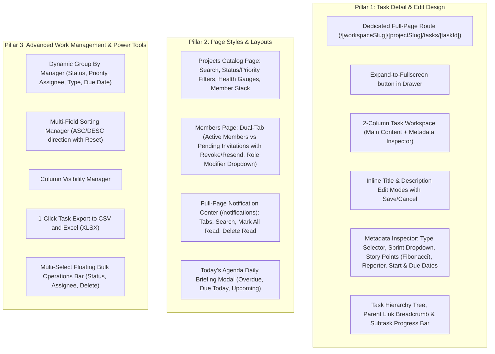

# Comprehensive Implementation Plan: Complete Taskosaur Parity (Task Edit Design, Page Styles & Advanced Work Management)

## 1. Executive Summary

Based on an exhaustive, file-by-file audit of `/home/saswatranjanmohanty/Desktop/HysProject/taskosaur/frontend` against `@orbito/platform`, this plan directly addresses the user's feedback:
> *"I think still many page style, task edit design and different things are still missing that are already present in Taskosaur."*

While backend capabilities and baseline features exist, Taskosaur features a rich, polished **2-column Task Edit & Detail Workspace**, a **dedicated Full-Page Task View route**, **Project Health & Heatmap gauges**, **Pending Invitations & Member Role management**, **Full-Page Notification Center**, **Dynamic Grouping & Sorting**, and **Spreadsheet Exports**.

---

## 2. Core Pillars of This Plan

---

## 3. Ordered Vertical Task Slices

### Slice 1: Task Edit Design & Dedicated Full-Page Task View
**Description:** Build the dedicated full-page task route `/[workspaceSlug]/[projectSlug]/tasks/[taskId]/page.tsx` and refactor the task view into a reusable 2-column workspace (`TaskDetailWorkspace.tsx`) used by both the full-page view and the drawer.
**Acceptance Criteria:**
- [ ] Route `/[workspaceSlug]/[projectSlug]/tasks/[taskId]` renders the full task detail page with breadcrumb navigation back to the board.
- [ ] TaskDetailDrawer features an "Expand to Fullscreen" icon (`Maximize2`) that navigates to the full-page route.
- [ ] Inline Title editing with Save (`Check`) / Cancel (`X`) and edit button (`Pencil`).
- [ ] Inline Description editing with Markdown toolbar, `[Write]` / `[Preview]` tabs, and AI generator.
- [ ] Metadata Inspector sidebar features:
  - Task Type selector (Task, Bug, Story, Epic, Subtask) with color badges and icons.
  - Sprint selector dropdown (Active Sprint vs. Backlog).
  - Story Points selector (1, 2, 3, 5, 8, 13 Fibonacci score).
  - Start Date and Due Date pickers with relative formatting ("Tomorrow", "Overdue").
  - Reporter avatar and selector.
  - Multi-assignee avatar stack with user search.
- [ ] Task Hierarchy section: Parent task link breadcrumb, subtask completion progress bar (`X of Y completed - Z%`), convert to subtask, promote to parent.

**Files likely touched:**
- `frontend/src/app/[workspaceSlug]/[projectSlug]/tasks/[taskId]/page.tsx` (new)
- `frontend/src/features/tasks/components/TaskDetailWorkspace.tsx` (new)
- `frontend/src/features/tasks/components/TaskDetailDrawer.tsx`
- `frontend/src/features/tasks/components/TaskHierarchy.tsx` (new)
- `frontend/src/lib/store/api/tasksApi.ts`

---

### Slice 2: Workspace Projects Catalog Page Styling
**Description:** Upgrade `/[workspaceSlug]/projects/page.tsx` into a high-craft project catalog with live search, status & priority filters, member stacks, and Project Health Indicators.
**Acceptance Criteria:**
- [ ] Live search input with debounced filtering by project name and description.
- [ ] Filter pills by Project Status (`ALL`, `ACTIVE`, `COMPLETED`, `ARCHIVED`) and Priority.
- [ ] Project cards display:
  - Project icon & key badge.
  - Circular SVG Health Score gauge (`ProjectHealthIndicator.tsx`).
  - Active sprint indicator.
  - Collaborator avatar stack.
  - Task count progress bar.
- [ ] Responsive grid layout with empty state and "+ New Project" modal trigger.

**Files likely touched:**
- `frontend/src/app/[workspaceSlug]/projects/page.tsx`
- `frontend/src/features/projects/components/ProjectHealthIndicator.tsx` (new)
- `frontend/src/features/projects/components/ProjectCard.tsx` (new or enhanced)

---

### Slice 3: Workspace Members & Pending Invitations Management
**Description:** Upgrade `/[workspaceSlug]/members/page.tsx` with a dual-tab architecture (`Active Members` vs `Pending Invitations`), member search, role change dropdowns, and invitation revocation/resending.
**Acceptance Criteria:**
- [ ] Tab 1: `Active Members ({count})`:
  - Search filter by member name/email.
  - Role modifier dropdown (`Select`) allowing managers/owners to change member roles (`MEMBER`, `MANAGER`, `VIEWER`) directly.
  - Remove member button with confirmation.
- [ ] Tab 2: `Pending Invitations ({count})`:
  - List of active invitation tokens querying `GET /api/invitations`.
  - Recipient email, role, expiration countdown badge.
  - 1-click "Copy Invite Link", "Resend Invite", and "Revoke Invite" actions.

**Files likely touched:**
- `frontend/src/app/[workspaceSlug]/members/page.tsx`
- `frontend/src/features/workspaces/components/PendingInvitationsList.tsx` (new)
- `frontend/src/lib/store/api/invitationsApi.ts`
- `frontend/src/lib/store/api/workspacesApi.ts`

---

### Slice 4: Dedicated Full-Page Notification Center (`/notifications`)
**Description:** Build the dedicated `/notifications/page.tsx` route matching Taskosaur's `NotificationScreen.tsx`, connected to the navbar popover.
**Acceptance Criteria:**
- [ ] Dedicated route `/notifications` accessible via "View all notifications" link in `NotificationPopover`.
- [ ] Category filter pills with unread count badges: `All`, `Task Assigned`, `Mentions`, `Status Changes`, `Invitations`.
- [ ] Search input filtering notification titles and messages.
- [ ] "Mark All as Read" button calling `POST /api/notifications/mark-all-read`.
- [ ] "Delete Read" button calling `DELETE /api/notifications/bulk`.
- [ ] 1-click deep link to navigate directly to referenced task or sprint.

**Files likely touched:**
- `frontend/src/app/notifications/page.tsx` (new)
- `frontend/src/features/notifications/components/NotificationCenter.tsx` (new)
- `frontend/src/components/layout/NotificationPopover.tsx`
- `frontend/src/lib/store/api/notificationsApi.ts`

---

### Slice 5: Advanced Tasks Organization (Dynamic Grouping, Sorting, Export & Bulk Bar)
**Description:** Upgrade `ProjectTasksPage.tsx` with dynamic grouping (`GroupByManager`), multi-field sorting (`SortingManager`), column customization (`ColumnManager`), 1-click CSV/Excel export, and floating multi-select bulk operations bar.
**Acceptance Criteria:**
- [ ] `GroupByManager`: Group tasks by `Status`, `Priority`, `Assignee`, `Task Type`, and `Due Date` across Kanban & List.
- [ ] `SortingManager`: Sort by Due Date, Priority, Created At, Title with ASC/DESC direction.
- [ ] `ColumnManager`: Toggle table column visibility.
- [ ] `taskExport.ts`: 1-click export of displayed tasks to **CSV** and **Excel (XLSX)**.
- [ ] Multi-select row checkboxes in List view triggering floating bottom bar with Bulk Status, Bulk Assign, and Bulk Delete.
- [ ] `TodayAgendaDialog`: Header & workspace briefing modal showing Overdue, Due Today, and Upcoming tasks.

**Files likely touched:**
- `frontend/src/features/tasks/components/GroupByManager.tsx` (new)
- `frontend/src/features/tasks/components/SortingManager.tsx` (new)
- `frontend/src/features/tasks/components/ColumnManager.tsx` (new)
- `frontend/src/features/tasks/utils/taskExport.ts` (new)
- `frontend/src/features/tasks/components/BulkActionsBar.tsx` (new)
- `frontend/src/features/tasks/components/TodayAgendaDialog.tsx` (new)
- `frontend/src/app/[workspaceSlug]/[projectSlug]/tasks/page.tsx`
- `frontend/src/components/layout/Navbar.tsx`

---

## 4. Verification & Clean Code Protocol

- Zero `any` policy with strict TypeScript interfaces.
- Obsidian monochrome styling (`#09090b` bg, `zinc-900` cards, 1px `border-zinc-800`, 4px radii `rounded-md`).
- Strict layer separation: UI -> RTK Query -> NestJS REST API.
- Compilation verification: `npm run build --workspace=@orbito/frontend` and `npm run build --workspace=@orbito/backend` must pass with 0 errors.
